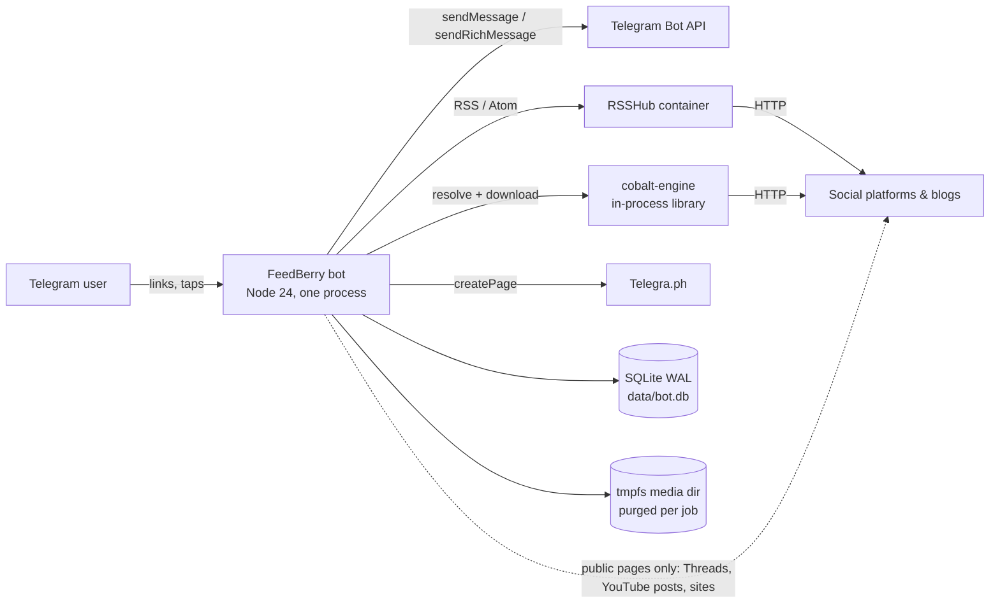
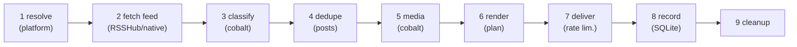

# FeedBerry Bot

**Fresh posts from the accounts you follow, re-published into Telegram as if the platform had posted them.**

FeedBerry watches blogs, news sites and social profiles, and for every new post sends one Telegram message:
the post's own words, original-quality media, full articles opened as Instant View — no ads, no watermarks,
no link dump. Everything that thinks lives in one process with one SQLite file, fed by long polling: no webhook,
no inbound port. The only other container is RSSHub, the feed sidecar.

- **Idle costs nothing.** A 30 s tick runs two cheap queries; work starts only from a due source, a user
  tap, or a retry.
- **No user credentials are stored.** Login-gated sources are refused instead of half-working (ADR-017).
- **Deterministic and testable.** 416 tests (unit + integration) run offline against fixtures and a fake
  Bot API.

Design: [docs/ARCHITECTURE.md](docs/ARCHITECTURE.md) · Plan: [docs/IMPLEMENTATION_PLAN.md](docs/IMPLEMENTATION_PLAN.md) ·
Decisions: [docs/adr/](docs/adr/) (001–028) · Runbook: [docs/RUNBOOK.md](docs/RUNBOOK.md) ·
Screens: [UI-Refference/](UI-Refference/)

**Status:** milestones M1–M12 shipped, including Download Mode, the schedule screen, keyword filters and the
rich-post layout. Production deploy and the restore drill are operator steps in the runbook.

---

## What it does

| Journey | What the user gets |
|---|---|
| **Subscribe to a source** | Paste a profile or site link; the bot checks it, shows its latest posts, and asks where to deliver. |
| **Download Mode** | Paste a single post link and get that post's media and text here, once, without subscribing. |
| **My Sources** | One screen listing every subscription: enable/disable, check now, change cadence, filter by platform, delete. |
| **Keyword filters** | Per-source and default keyword lists; a post only reaches a chat if it mentions one of them. |
| **Content kinds** | A YouTube channel can send Videos, Shorts, Community posts, or any mix of them. |
| **Schedules** | Default 08:00 and 20:00 in the owner's timezone, or a per-source interval from 15 min to 24 h. |
| **Languages** | English, Русский, Español, हिन्दी, தமிழ், Bahasa Indonesia. |
| **Private by default** | A new user is `pending` until the operator approves them in `/admin_panel`. |

---

## Architecture

One host, two containers. Everything that thinks is in the bot process; RSSHub is a sidecar.



| Component | Responsibility | Where |
|---|---|---|
| **Bot process** | grammY long polling, FSM, callback router, screens, access gate, admin panel | `src/bot/` |
| **Scheduler** | Every 30 s: which subscription is due, which job is runnable | `src/scheduler/` |
| **Queue + worker** | SQLite `jobs` table, single-statement claim, backoff ladders, concurrency `WORKER_CONCURRENCY` | `src/jobs/` |
| **Pipeline** | One file per stage; `run.ts` orchestrates stages 2–9 | `src/pipeline/` |
| **Platform layer** | Link detection, host allowlist, SSRF guard, feed adapters | `src/platform/` |
| **Renderer** | Payload → `MessagePlan` (classic rows or one rich post) | `src/render/` |
| **Sender** | The only caller of the Bot API for delivery, with the shared rate limiter | `src/telegram/` |
| **Media** | cobalt wrapper, ffprobe duration probe, thumbnail frames | `src/media/` |
| **Articles** | Readability → sanitize → Telegra.ph page (Instant View) | `src/article/` |
| **Observability** | JSON-line logs with secret redaction, alerts, `/status` | `src/obs/` |
| **RSSHub** | The locked feed engine for routes without a native feed (ADR-006) | `docker-compose.yml` |

Why one process and not three services: the FSM, the scheduler and the worker share the same SQLite file and
the same in-memory rate limiter, so splitting them buys nothing at this scale and only costs IPC (ADR-002).

### The pipeline



1. **resolve** — link → `SourceRef{platform, canonical_url, feed_url, strategy}` or a coded error. Pure, no network.
2. **fetch feed** — native RSS/Atom/RDF with discovery and sitemap fallback, an RSSHub route, the Bluesky
   AppView, or a post's own permalink page.
3. **classify** — `cobalt.resolve()` metadata only (~1 s, no bytes) to pick `album / photo / video / audio / article / link`.
4. **dedupe** — `posts(source_id, guid)` unique; `guid` is the feed's id or `sha256(link)`.
5. **prepare media** — size gate, duration probe, poster fetch, then the download inside one job (CDN URLs are
   IP-bound and expire in minutes).
6. **render** — a `MessagePlan`: classic text/album/article rows, or one rich post (see below).
7. **deliver** — `TelegramSender`, serialized per chat, rate limited.
8. **record** — `deliveries`, `posts`, source health, `events`.
9. **cleanup** — the temp dir is purged on every path, including failures.

A scheduled check is stages 2–9 for every subscriber. A pasted link (Download Mode) is stages 3–7 into the
current chat — the same code, the same decisions; a parity test compares both doors' output byte for byte
(ADR-013, ADR-028).

### Scheduling, queue and retries

- **Slots.** `subscriptions.next_slot_at` is 08:00/20:00 in the subscription owner's timezone, or
  `now + interval_minutes` for a per-source override. One fetch per source serves every active subscriber;
  the tick advances the slot **before** the job runs, so a crash cannot produce a hot loop.
- **Queue.** `fetch_source | deliver_post | manual_check | cleanup`. Priority: manual 100, scheduled 50,
  backfill 40, retry 10. A claim is one `UPDATE … RETURNING` statement, so two workers can never take the
  same job; a `running` row older than 10 min is reset to `queued`.
- **Retries.** Network/5xx: 1 m, 5 m, 25 m, 2 h, 6 h (5 attempts). Platform rate limit: 30 m, 2 h, 8 h (3).
  Login wall: no retry, the source is marked and the owner told once. A failed delivery retries without
  re-downloading media. After the last attempt the owner gets one message per source per 24 h.

### Storage

SQLite in WAL mode, `busy_timeout=5000`, one writer, schema version in `PRAGMA user_version` with in-place
migrations. Eight tables: `users`, `chats`, `sources`, `subscriptions`, `posts`, `deliveries`, `jobs`,
`events`. Posts are retained `MAX_SOURCE_AGE_DAYS` days, events 30 days, both pruned by the daily `cleanup`
job. There is no credential table and no credential column — that is a design decision, not an omission.

---

## User journeys and screens

The FSM (in-memory, keyed by Telegram user id) lives in [src/bot/session.ts](src/bot/session.ts). A restart
forgets where a user was, which is safe because every screen can be re-rendered from the database. States:

```
idle · awaiting_source_link · checking · preview · add_mode · done · error · confirming_delete
choosing · choosing_types · awaiting_keywords · awaiting_admin_* · confirming_admin_*
```

Screens S1–S11 map 1:1 to the normative screenshots in [UI-Refference/](UI-Refference/); S16 (schedule) and
S18 (content kinds) were added afterwards.

### Add a source

1. `➕ Add Source`, `/addsource`, or simply paste a link → state `awaiting_source_link`. One link per message.
2. `⚪ Checking source:` — stage 1 detects the platform, stage 2 fetches the feed. A category page resolves
   to its own section feed; a page with no feed is offered as an article source (ADR-018, ADR-021).
3. **Preview** — the source's last 5 items, plus the destination list: the personal chat first, then every
   chat or channel where the bot's posting rights were verified (ADR-014). A forum topic is its own row.
4. **How to add** — `🚀 Add and send latest posts` (sends `BACKFILL_COUNT` newest, oldest → newest),
   `➕ Add without sending` (records everything as seen), or `🔑 Keywords` to filter before saving.
   A YouTube channel asks for its content kinds first.
5. **Confirmation.** Everything already in the feed is recorded as seen, so only genuinely new posts arrive.

### Download Mode

Paste a post link and the bot answers with one prompt: `⬇️ Download`, and `➕ Add source` when the account
behind the link is known. The download reuses stages 3–7 (ADR-013), is capped by `MAX_DOWNLOADS_PER_DAY`, and
ends with `⬇️ Download more` and `➕ @handle` when the account is known. A YouTube community post and a
Threads thread are read from their own page, so the whole text, every photo of an album and the author
survive; any other platform's post goes through cobalt. Inside Download Mode a profile link is answered with
`Send a post link, not a profile.`

### My Sources

One message, edited in place, 5 cards per page, platform filter chips. Each card carries the source title,
`id: #<id>`, its last check, its health, and its own action row: **On/Off**, **Check now** (a `manual_check`
job at priority 100), **content kinds** (YouTube), and **Delete** behind a confirm. Toasts report the result
without touching the list.

### Keyword filters, schedule, language

- `/filter` (or `📇 Filter`): a default list plus a per-source list. Matching runs on the parsed payload
  **before** any media download, so a skipped post costs nothing (ADR-020).
- `/schedule` (or `⏰ Schedule`): pick a source (or all sources) and choose default 08:00/20:00, or every
  15 min / 30 min / 1 h / 3 h / 6 h / 12 h / 24 h. A source keeps one schedule for all its subscribers.
- `/language`: six interface languages; a partial translation falls back to English, never to a blank screen.

### Access gate and admin panel

The bot is private. A stranger's first update is denied once, logged as `access_requested`, and surfaced in
`/admin_panel`; the operator approves or blocks, and can message one user or all of them. `ADMIN_CHAT_ID`
bypasses the table and is the only id that `/status` answers.

---

## Supported platforms

Legend — the bot prefers the cheapest route that works: a native feed, then RSSHub, then the platform's own
post page, then cobalt for the media. Full matrix with failure modes: ARCHITECTURE §10.

| Platform | Profile source | Single post |
|---|---|---|
| Websites, blogs, news | native RSS/Atom/RDF, `<link rel=alternate>` discovery, then `/sitemap.xml` as a page list | article → Telegra.ph |
| Substack | always `<origin>/feed` — no fetch needed | same |
| YouTube | keyless `feeds/videos.xml` per channel; Posts tab read as a second feed | `/post/…` page adapter, or cobalt for video/Shorts |
| Tumblr | the blog's own `/rss` | cobalt |
| Bluesky | public AppView `getAuthorFeed`, no key | cobalt |
| TikTok | RSSHub `/tiktok/user/…` | cobalt (short links, photo carousels) |
| Threads | RSSHub `/threads/…` | the permalink page renders the whole thread |
| Instagram | RSSHub `/instagram/user/…` | `/p/`, `/reel/`, `/tv/` via cobalt |
| Facebook | RSSHub `/facebook/page/…` (needs a cookie on a datacenter IP) | videos, reels, photos, `fb.watch` |
| Pinterest | RSSHub user route; `/ideas/` and `/search/` are rejected as browse pages | pins, `pin.it` |
| X / Twitter | only with an operator-supplied `TWITTER_AUTH_TOKEN` | posts via cobalt |
| Snapchat | not subscribable (no feed exists) | Download Mode only |
| Telegram channels | beta, opt-in (`TELEGRAM_BETA`), public `t.me/s` page | cobalt |
| Reddit | removed: RSS ends 2026-11-13, public API by March 2027 | — |

---

## Message layout and delivery limits

Two layouts, chosen by platform:

- **Social posts (non-RSS)** ship as **one rich message** (Bot API 10.x `sendRichMessage`): an `<h5>` source
  line, `⏱️` bold `DD/MM HH:MM` in the reader's timezone, an in-message `<tg-slideshow>` of up to 50 media,
  then the whole body inside a `<blockquote expandable>` framed by two rules — one native tap expands it, with
  no stored payload and no callback. A clip that cannot upload is one `🎬 Video n` link (ADR-023, ADR-025).
- **RSS/blog posts** use the classic rows: text split on word boundaries at 4096 chars (captions at 1024 with
  `(i/n)`), albums of 2–10 via `sendMediaGroup` with sequential messages past 10, mixed kinds sent one by one,
  and articles as a Telegra.ph page opened in Instant View.

Hard limits, all enforced:

| Limit | Behavior |
|---|---|
| 50 MB upload | above it: poster/thumbnail + caption + link. Nothing is transcoded (ADR-012) |
| 3 minutes of video | same thumbnail route, whatever the size |
| Over-sized clip inside an album | an ffmpeg frame takes its slot, the caption gains one labelled `🎬` link; the clip is never uploaded and never silently dropped (ADR-022) |
| 100 MB per post | `MAX_DOWNLOAD_MB` pre-check before any transfer |
| 30 s / 300 s budgets | extraction (resolve, probes, posters) vs. transfer — one budget per kind of operation, shared by both doors (ADR-028) |
| 1 msg/s per chat, 20/min per group, 30/s global | token buckets in a shared limiter; `429` honors `retry_after` + 1 s, and a `retry_after` over 300 s requeues the job |
| 4096 / 1024 characters | split on a word boundary, never inside an HTML tag; a client that rejects the entities gets plain text instead |

---

## Tech stack

| Layer | Choice | Note |
|---|---|---|
| Runtime | Node.js **≥ 24**, ESM | `node:sqlite` needs 24; TypeScript is type-stripped, no build step for `dev` |
| Language | TypeScript 7 (`tsc` for typecheck + `dist/`) | ~10 typed boundary objects justify it |
| Bot framework | grammY 1.46 | Long polling, `allowed_updates: message, callback_query, my_chat_member` |
| Storage | SQLite (WAL) via the built-in `node:sqlite` | No native build step; migrations on boot |
| Queue | Own `jobs` table | One writer, atomic claim, backoff in `run_after` |
| Feeds | RSSHub (sidecar), native RSS/Atom/RDF, Bluesky AppView | No public RSSHub instance (ADR-006) |
| Media | `cobalt-engine` vendored and imported as a library | In-process, no media service (ADR-005) |
| Video | ffmpeg / ffprobe | In the image; muxing and the 1 s thumbnail frame |
| Articles | `@mozilla/readability`, `jsdom`, `sanitize-html` → Telegra.ph | The ported formatbot1 path (ADR-007) |
| Logs | JSON lines to stdout, `events` table | Tokens, cookies and access keys redacted |
| Container | `node:24-alpine` + ffmpeg, `diygod/rsshub:latest` | No Chromium in either image |

## Repository layout

```
src/
  main.ts        boot: config → db → bot → worker → tick
  config.ts      env parsing; every limit lives here
  bot/           long polling, FSM, callback router, screens, keyboards, texts, i18n, access gate, admin
  pipeline/      one file per stage; run.ts orchestrates stages 2–9
  platform/      link detection, allowlist, SSRF guard, feed adapters (native, section, Threads, YouTube post)
  render/        payload → MessagePlan (classic rows, rich text, albums, caption splitting, video rules)
  telegram/      the only Bot API caller: sender, shared rate limiter, "Show more"
  media/         cobalt wrapper, video probe, thumbnail frames
  article/       Readability → sanitize → Telegra.ph
  jobs/          SQLite queue (claim, backoff) + worker pool
  scheduler/     per-subscription slots + the 30 s tick
  db/            schema.sql, open/migrate, one repo per table
  obs/           JSON-line logs with redaction, alerts, /status
test/
  unit/          pure functions, fixtures, no network
  integration/   the real handlers over a fake Bot API (test/fake-api.ts)
cobalt-engine/   the locked media engine, imported as a library
docs/            ARCHITECTURE, IMPLEMENTATION_PLAN, RUNBOOK, expandable-quotes, adr/001–028
UI-Refference/   normative screen screenshots
data/            the SQLite file at runtime (git-ignored)
```

---

## Run it locally

Requires **Node.js 24+**, a bot token from [@BotFather](https://t.me/BotFather), and an RSSHub you control.

```bash
npm install
cp .env.example .env         # BOT_TOKEN, ADMIN_CHAT_ID, RSSHUB_BASE
npm run dev                  # runs src/ directly, no build step
npm test                     # offline: fixtures + a fake Bot API
```

`npm run build && npm start` runs the compiled `dist/`. `npm run typecheck` is the type gate.

Notes for a local run:

- `RSSHUB_BASE` must point at an RSSHub the bot can reach. The sidecar in `docker-compose.yml` publishes no
  port and is reached as `http://rsshub:1200` from inside the compose network; for a host run, start your own
  RSSHub (or add a `ports` mapping) and set `RSSHUB_BASE=http://localhost:1200`.
- `ADMIN_CHAT_ID` is your numeric Telegram id — the admin bypasses the access gate. Anyone else starts as
  `pending` and must be approved in `/admin_panel`.
- ffmpeg/ffprobe on the host improve video handling (duration probe, thumbnails); without it the bot falls
  back to unknown-duration rules.
- One bot token can be polled by one process at a time. Running a local copy against the live token while the
  hosted container runs gives both sides `409` conflicts.

## Deploy with Docker

```bash
cp .env.example .env         # fill the three required values
docker compose up -d         # bot + rsshub
docker compose logs -f bot   # wait for {"code":"polling_started"}
```

- `bot` is built from this repo (`node:24-alpine` + ffmpeg), restarts `unless-stopped`, keeps SQLite in
  `./data:/data`, and keeps downloaded media in a 512 MB tmpfs that never touches disk.
- `rsshub` runs without Chromium, caches in `./rsshub-cache`, and gets the instance-wide credentials
  (`TWITTER_AUTH_TOKEN`, `INSTAGRAM_COOKIE`, `FACEBOOK_COOKIE`) that the bot itself must never see —
  compose explicitly clears the two cookies from the bot's environment.
- Update with `git pull && docker compose build bot && docker compose up -d`; a rebuild is only needed when
  `package.json`, `Dockerfile`, `cobalt-engine` or `schema.sql` changed.
- First-start procedure, backups, the restore drill, Oracle caveats and the platform smoke list live in
  [docs/RUNBOOK.md](docs/RUNBOOK.md).

---

## Configuration

Everything is env, parsed once at boot ([src/config.ts](src/config.ts)); a malformed value stops the bot with
a readable message instead of guessing.

### Required

| Variable | Meaning |
|---|---|
| `BOT_TOKEN` | Bot token. Never logged, never stored. |
| `ADMIN_CHAT_ID` | Operator's numeric Telegram id: alerts, `/status`, the admin panel. |
| `RSSHUB_BASE` | Your RSSHub, e.g. `http://rsshub:1200`. Public instances are not used (ADR-006). |

### Paths and optional services

| Variable | Default | Meaning |
|---|---|---|
| `DB_PATH` | `data/bot.db` | SQLite file; in Docker it is `/data/bot.db`. |
| `TELEGRAM_API_ROOT` | — | A self-hosted Bot API server, or the fake one in tests. |
| `TELEGRAPH_TOKEN` | — | Pin one Telegra.ph account. Empty: the bot creates one once and stores the token next to the database. |

### Limits and quotas

| Variable | Default | Meaning |
|---|---|---|
| `MAX_SOURCES_PER_USER` | 250 | Per user; rendered as `Sources: N / 250`. |
| `MAX_CHATS_PER_USER` | 20 | Validated on add. |
| `MAX_DOWNLOAD_MB` | 100 | Pre-check before any media download. |
| `BACKFILL_COUNT` | 5 | How many posts "Add and send latest posts" sends. |
| `MAX_SOURCE_AGE_DAYS` | 30 | Retention for `posts`. |
| `WORKER_CONCURRENCY` | 2 | Keep at or below the CPU core count. |
| `MAX_DOWNLOADS_PER_DAY` | 300 | Download Mode quota, per user per day. |
| `CALLBACK_INTERVAL_MS` | 2000 | Per-user tap throttle; `0` disables it. |
| `ADD_INTERVAL_MS` | 10000 | Per-user add throttle; `0` disables it. |
| `CHECKS_PER_HOUR` | 30 | Manual "Check now" ceiling per user; `0` disables it. |

### Feature flags and instance credentials

| Variable | Default | Meaning |
|---|---|---|
| `TRIAL_ENABLED` | false | Shows the cosmetic trial line on the main menu (OQ-7). |
| `TELEGRAM_BETA` | false | Telegram channel sources through the public `t.me/s` page (OQ-3). |
| `TWITTER_AUTH_TOKEN` | — | The `auth_token` of a logged-in X account. Present: X profiles become subscribable and gated X media downloads work. Absent: only public X posts. Also passed to the RSSHub sidecar. |
| `INSTAGRAM_COOKIE` | — | `sessionid=…; ds_user_id=…`. **RSSHub container only** — compose clears it from the bot. |
| `FACEBOOK_COOKIE` | — | The whole `Cookie` header of a logged-in Facebook session. **RSSHub container only.** |

---

## Operating it

| Task | How |
|---|---|
| Health | `/status` in the admin DM: queued/running/failed jobs, failing sources, 24 h fetch and send counters |
| Logs | `docker compose logs -f bot` — one JSON line per job with job, source, stage, ms, code |
| Backup | `sqlite3 data/bot.db ".backup 'backups/bot-$(date +%F).db'"`, then copy it off the box |
| Restore | stop the bot, replace `data/bot.db`, start — a file copy, with no migration step to forget |
| Users | `/admin_panel`: approve, block, inspect a user's sources, message one user or all of them |
| Alerts | 3 consecutive failures on one source, more than 100 queued jobs, or no successful fetch in 26 h |

Scheduled failures are quiet for readers: the source's health fields and the `events` trail are updated, and
the operator gets at most one DM per source per 24 h. Users only see error screens for actions they started.

## Tests

```bash
npm run typecheck   # tsc --noEmit
npm test            # node:test, unit + integration, 416 tests, no network
npm run build       # dist/ + schema.sql
```

Integration tests drive the real handlers and the real pipeline against `test/fake-api.ts` — a local server
that speaks the Telegram API shape — with fixture feeds and a fixture media engine. No token, no network, no
live social URLs. The restore drill is covered the same way by taking a `VACUUM INTO` snapshot of a live
database and reading it back.

## Known limits

- **Fidelity.** Telegram HTML supports text formatting and links: no custom fonts, CSS, image grids or
  carousel chrome. Media order + the post's words + the author line is the maximum, and this project never
  claims a pixel-identical copy.
- **"Instant View" is a Telegra.ph rewrite.** Telegram's IV works per domain and a bot cannot register a
  template, so articles become a Telegra.ph page (which already has one) and the link is sent. On failure the
  original link goes instead (ADR-007). The Cocoon AI summary above such a page is Telegram's, not the bot's.
- **No credentials, ever.** A login-gated profile is refused at add time (`E_COOKIE_REQUIRED`) or fails its
  fetch; single posts still work in Download Mode. Instance-wide RSSHub cookies belong to the sidecar.
- **No transcoding, no CAPTCHA solving, no proxy pools.** Above 50 MB, or on a clipping 3-minute video, the
  post arrives as poster + caption + link.
- **A datacenter IP is throttled first** by the platforms in ARCHITECTURE §10. Expect more `E_RATE_LIMIT` and
  `E_COOKIE_REQUIRED` on a cloud host than on a home connection.
- **One host, one writer.** SQLite and a single process are the design (ADR-009); the queue is meant for
  hundreds of sources, not for horizontal scaling.
- **No AI features ship.** The pipeline exposes a hook point after `render`; nothing is registered in it.

## Legal

FeedBerry prefers official feeds, stores no user credentials, and never resells or shares content. Some
platforms (notably X) forbid automated scraping without written permission; per-platform risk is documented
in ARCHITECTURE §10. Read the current terms of a platform before enabling it. This is a risk statement, not
legal advice.

## License

Not chosen yet (intentionally deferred).
