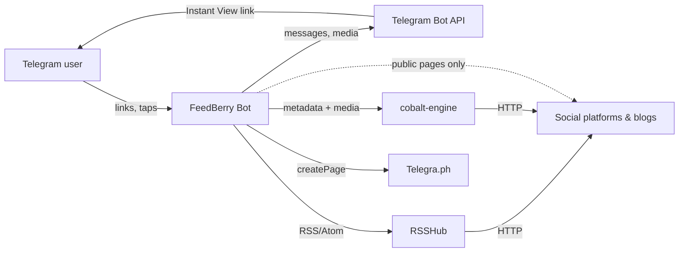
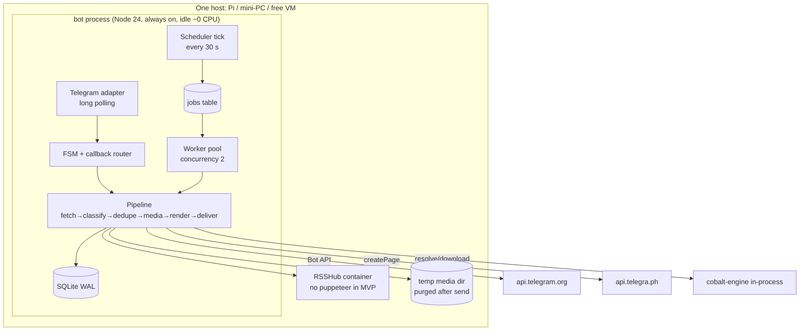
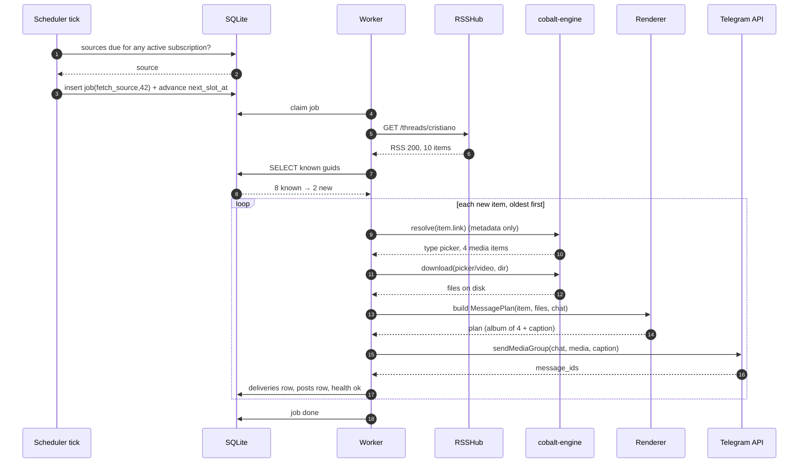
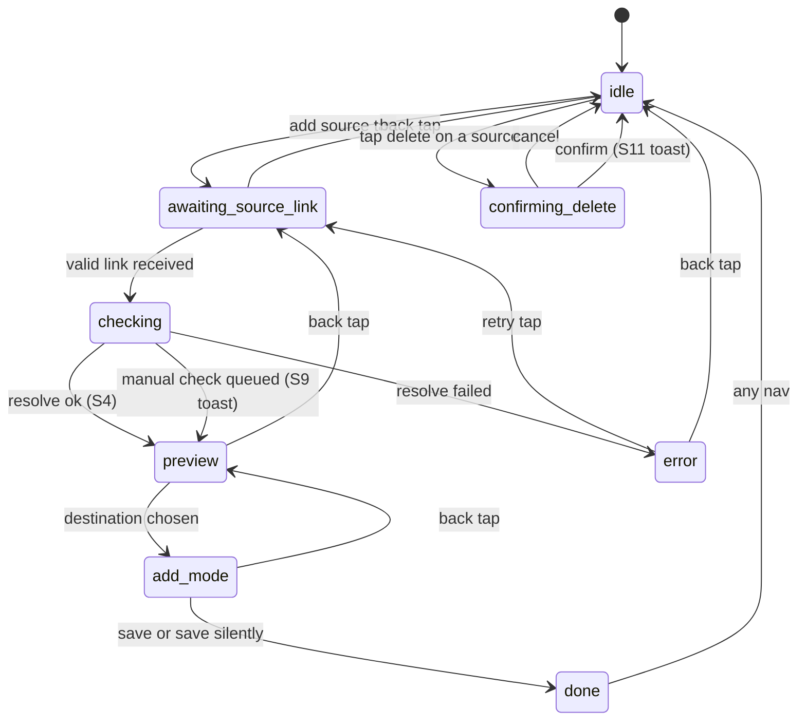

# FeedBerry Bot — Architecture Design Document

**Status:** implemented — M1–M9 complete, plus post-milestone work (Threads/YouTube post adapters, M10–M12 UX and schedule screen). 130 tests green. Runtime amended to Node 24 (ADR-001). Production deploy + the restore drill are pending operator steps (RUNBOOK).
**Date:** 2026-10-29
**Audience:** the sessions that implemented this (M1–M12), plus whoever operates it
**Scope:** the design record. Application code, dependencies and scaffolding were added during implementation; progress is tracked in [IMPLEMENTATION_PLAN.md](IMPLEMENTATION_PLAN.md) and [README.md](../README.md).

---

## 0. How to read this document

Every external fact carries a short reference such as `[TG-FAQ]`; all references resolve in
[§16 Sources](#16-sources). Anything I could not verify against a primary source is tagged
`[assumption]`. Local engine facts cite files in this repository.

Locked inputs (do not redesign):

| Input | Where | Status |
|---|---|---|
| UI screens S1–S11 | `UI-Refference/*.png` | normative; `docs/UI_SPEC.md` was **not** present, so callback names and toast strings below are **derived** and marked *(derived)* |
| Media engine | `cobalt-engine/` | locked, importable library `[COBALT-README]` |
| Feed engine | RSSHub | locked deployment dependency `[RH-DEPLOY]` |
| Article → Instant View | `src/article/` | locked approach: formatbot1's Telegra.ph rewrite, ported into our code `[FB-TELEGRAPH]` |

---

## 1. Goals, non-goals, constraints, assumptions

### 1.1 Goals

1. One Telegram message per new post, looking like the platform's own post, with original-quality,
   watermark-free media.
2. Free to run and near-zero idle cost: no polling of feeds while nothing is due.
3. Sources: websites/blogs, Instagram, X/Twitter, Bluesky, TikTok, Snapchat, Tumblr, Pinterest,
   Facebook, YouTube, Threads, plus Reddit and Telegram per the UI.
4. Delivery to DM, group, channel, forum topic — with admin rights proven before a chat is stored.
5. Deterministic, testable pipeline that a later session can implement from this file alone.

### 1.2 Non-goals (explicitly out)

- AI routing, summaries, digests, rephrasing, ad detection, custom prompts. Only a hook is defined (§5.7).
  The Cocoon AI summary that Telegram shows on top of an Instant View article is not bot AI (§8.5).
- Billing, plans, trials. The S1 screenshot shows `Plan: Free Trial` and `Trial ends: …`; see OQ-7.
- Multi-tenant SaaS, horizontal scaling, HA.
- Web UI, mobile app, or a second bot.
- Transcoding media (see OQ-5) and paid CAPTCHA/anti-bot services.

### 1.3 Constraints

| ID | Constraint | Consequence |
|---|---|---|
| C1 | Free to run | No paid APIs, no paid proxies, no paid CAPTCHA solving, no managed queue |
| C2 | Low power, nothing runs while idle | Idle = no fetch, no browser, no CPU-heavy loop. Work only from a due source or a user tap |
| C3 | Engines locked | RSSHub for feeds, cobalt-engine for media, formatbot1's Telegra.ph path for IV |
| C4 | Telegram limits are hard limits | 4096 chars, 1024 caption, 50 MB upload, ~1 msg/s per chat, ~20/min group, ~30/s global `[TG-MSG][TG-FAQ]` |
| C5 | UI is normative | Screens, buttons, toasts as in the screenshots |
| C6 | MVP only | No feature that is not on the screens or in this document |

### 1.4 Assumptions

| ID | Assumption | Why it is safe | If wrong |
|---|---|---|---|
| A1 | The host is a single machine owned by the operator (Pi/mini-PC) or one free VM | C2 | Revisit ADR-010 |
| A2 | Expected scale at launch: ≤ 200 sources, ≤ 50 chats, ≤ 5k posts/day `[assumption]` | Fits SQLite and one process | ADR-009 revisit at ~50 writes/s |
| A3 | ffmpeg/ffprobe can be installed on the host | cobalt needs it only for YouTube muxing/HLS `[COBALT-README]`; we also want it for duration probing | §8.6 fallback |
| A4 | No user credentials are stored: login-only sources are refused, and blocked media falls back to a link card (ADR-017) | §10 tiers, §12 | The source cannot be added; single posts still work in Download mode |
| A5 | Duration is not exposed by `resolve()` — verified in source `[COBALT-ENGINE:L96-L110]` | It changes §8.6 | Roadmap item R-3 |

---

## 2. System context and components

### 2.1 Context



### 2.2 Components



Why one bot process and not three services: FSM, scheduler and worker share the same SQLite file and
the same in-memory rate limiter. Splitting them buys nothing at this scale and costs IPC (ADR-002).

---

## 3. Runtime and language

**Decision: TypeScript on Node.js 24, one process, ESM.** ADR-001 (amended from Node 22 — built-in `node:sqlite` needs 24).

| Engine | Runtime it forces | Evidence |
|---|---|---|
| cobalt-engine | Node ≥ 18.17, `"type": "module"`, imports `fetch` directly | `cobalt-engine/package.json`, `cobalt-engine/README.md` |
| article logic (ported from formatbot1) | Node ≥ 21, needs `jsdom`, `@mozilla/readability`, `sanitize-html` | `package.json`, `src/article/` |
| RSSHub | Node + optional Chromium; runs as a container | `[RH-DEPLOY]` |

A JVM or Python bot would have to shell out to Node for cobalt (process spawn per post), or run a
second HTTP service, which increases idle memory and adds a failure domain with zero benefit.
**JVM is rejected** for that reason; **Python is rejected** for the same reason.

TypeScript over plain JS: the pipeline has ~10 typed boundary objects (feed item, resolve result,
render plan, delivery result) and mistakes there surface as user-visible bad messages.

Bot framework: **grammY** (ADR-001). Alternatives: Telegraf 4.x (already used by formatbot1
`[FB-README]`, viable), raw Bot API over `fetch` (more code for FSM/callbacks), python-telegram-bot
(rejected with Python).

---

## 4. Scheduler and queue design

### 4.1 Idle-zero model

- One process, one `setInterval` tick of **30 s**. The tick runs **two cheap queries**; if both return
  nothing, it does no I/O. That is the entire idle cost (well under 1 % CPU `[assumption]`).
- Telegram updates arrive over **long polling** (`getUpdates`, 25 s server timeout). One request per
  25 s when idle, no inbound port, no TLS, no tunnel. ADR-003.
- Heavy work starts only from: (a) a due source, (b) a user tap, (c) a retry timer.

### 4.2 The two tick queries

```sql
-- 1. is any source due?
SELECT s.id FROM sources s
JOIN subscriptions sub ON sub.source_id = s.id AND sub.active = 1
WHERE s.enabled = 1 AND sub.next_slot_at <= :now
GROUP BY s.id;

-- 2. is any job runnable?
SELECT id FROM jobs
WHERE state = 'queued' AND run_after <= :now
ORDER BY priority DESC, run_after ASC LIMIT 1;
```

If query 1 returns rows, insert one `fetch_source` job per source (`UNIQUE(kind, target_id)` while
queued, so a slow source cannot be enqueued twice) and advance every due `next_slot_at` to its next
slot **before** the job runs. Advancing first means a crash cannot produce a hot loop.

### 4.3 `next_slot_at`: per-subscription slots, one fetch per source

The default is 08:00 and 20:00 **in the subscription owner's timezone**. A per-source interval
override replaces the two slots with `now + interval`.

```
slot_after(now, tz, interval_minutes):
  if interval_minutes is set:  return now + interval_minutes
  for h in [8, 20]: next occurrence of h:00 in tz that is > now
  return the earlier of the two
```

`subscriptions.next_slot_at` holds that value per subscription. The scheduler fetches a source when
**any** active subscription is due, then delivery goes to **all** subscriptions of that source whose
`deliver` flag is on. This is how "one fetch per source, shared across subscribers" and "08:00/20:00
user time" coexist without fetching twice. Full rationale in ADR-004.

### 4.4 `jobs` semantics

| Column | Meaning |
|---|---|
| `kind` | `fetch_source` \| `deliver_post` \| `manual_check` \| `cleanup` |
| `target_id` | source id or post id |
| `priority` | manual = 100, scheduled = 50, backfill = 40, retry = 10 |
| `run_after` | earliest start (backoff lives here, not in a sleep) |
| `attempts` | incremented on claim |
| `state` | `queued` \| `running` \| `done` \| `failed` |
| `locked_at` | crash detection: `running` older than 10 min is reset to `queued` |

Claim is one statement, so two workers can never take the same job:

```sql
UPDATE jobs SET state='running', locked_at=:now, attempts=attempts+1
WHERE id = (SELECT id FROM jobs WHERE state='queued' AND run_after<=:now
            ORDER BY priority DESC, run_after LIMIT 1)
RETURNING *;
```

### 4.5 Retries and backoff

| Failure | Backoff | Max attempts |
|---|---|---|
| Network / 5xx / RSSHub 502 | 1 m, 5 m, 25 m, 2 h, 6 h | 5 |
| Platform rate limit (`error.fetch.rate`) | 30 m, 2 h, 8 h | 3 |
| Login wall (401/403) | none — mark source `needs_login`, tell the owner once; link-only | 1 |
| Telegram 429 | `retry_after` + 1 s, then continue | unlimited (bounded by 24 h age) |
| Media too large / unsupported | none — render fallback immediately | 1 |

After the last attempt the source keeps its `last_error_code`, and the owner gets **one** message per
24 h, not one per failure.

### 4.6 Manual recheck path

`src:check:<id>` callback → `answerCallbackQuery("Queued for a check — …")` (S9) → insert
`manual_check` job at priority 100 with `run_after = now`. If the same source already has a queued
job, the insert is a no-op and the toast is identical. Manual checks **do not** move `next_slot_at`.

---

## 5. Fetch pipeline

### 5.1 Stages

| # | Stage | Input | Output | Notes |
|---|---|---|---|---|
| 1 | `resolve` | user link | `SourceRef{platform, canonical_url, external_id, feed_url, strategy}` | pure function + one HEAD/GET if needed |
| 2 | `fetch_feed` | `source.feed_url` | `FeedItem[]` | RSSHub or native RSS `[RH-DEPLOY]` |
| 3 | `classify` | item | `kind` + `MediaPlan` | uses `cobalt.resolve()` metadata-only, ~1 s, no bytes `[COBALT-README]` |
| 4 | `dedupe` | items | new items only | `posts(source_id, guid)` unique |
| 5 | `prepare_media` | item + plan | files in temp dir | streamed, size-checked, duration probed |
| 6 | `render` | item + files | `MessagePlan` | §8, pure function, unit-testable |
| 7 | `deliver` | plan + chat | message ids | §9, rate limited |
| 8 | `record` | result | rows | `deliveries`, `posts`, health |
| 9 | `cleanup` | temp paths | deleted files | always runs, also on error |

Stages 3–7 are also the **Download mode** (OQ-8): same code, no subscription, target = the chat that
sent the link. The brief calls this "pipeline steps 2–7"; stage 2 (feed fetch) has no meaning for a single
link, so it is skipped rather than faked.

### 5.2 Sequence: scheduled check → delivered post



### 5.3 Fetch adapter selection

| `strategy` | Feed URL | Used for |
|---|---|---|
| `native_rss` | the site's own `/feed`, `/rss`, `feed.xml`, or a discovered `<link rel=alternate>` | blogs, Tumblr, YouTube, WordPress, most news |
| `rsshub` | `${RSSHUB_BASE}${route}` | Instagram, X, TikTok, Threads, Pinterest, Facebook, Telegram (beta) |
| `bluesky_api` | `getAuthorFeed` on the public AppView `[BSKY-API]` | Bluesky (no key, no RSSHub) |
| `single_post` | the link itself | Download mode. A Threads thread and a YouTube community post are read out of their own permalink page (`platform/feed/threads.ts`, `platform/feed/youtube-post.ts`); every other platform goes to cobalt |

Discovery order for a plain website: (1) URL is already a feed; (2) `<link rel="alternate"
type="application/rss+xml">`; (3) common paths; (4) give up with `E_NO_FEED` and offer "add as article
source" — an article source checks the page for new links, not an RSS feed (same pipeline, `classify`
always returns `article`).

A category URL is a source of its own (ADR-018). `sectionOf` reads the section path off the URL, so
`/category/science` and `/top-stories/155` are sources in every screen. A one-segment page (`/technology`)
is ambiguous, so free text resolves it before choosing a flow: a page with a section feed goes straight to
the preview, a page without one keeps the Download/Add chooser. Stage 2 resolves the section feed in order: the feed the page
scopes to itself, `<section>/feed` or `/rss`, an alias the page links to itself (`bbc.com/technology` →
`/news/technology/rss.xml`), a feed directory the page links (matched by the section id), and last the
site-wide feed filtered by `<category>` tags or item URL. A page that resolves to nothing is the site it
belongs to; a section with no feed at all is `E_NO_FEED`, never an empty subscription.

Formats and budgets (ADR-019): discovery reads RSS 2.0, Atom 1.0 and RSS 1.0 (RDF) documents, and a feed's
charset comes from its BOM, then its own `<?xml encoding=?>` declaration, then the transport — one
`decodeBody` for every response. A pasted URL whose path names a feed (`/feed`, `/rss/…`, `/atom`, `*.xml`)
is used as that feed directly, wherever the marker sits in the path. The guessed-path fallback (`/feed`,
`/rss`, …) shares one 20 s budget, so a
dead site cannot hold a worker job for five timeouts. A typed `rss`/`atom`/`rdf` alternate stays
authoritative and is never guessed past; a plain `application/xml` one may be a sitemap, so it falls through to
the next alternate and then to the guessed paths.

### 5.4 De-duplication and "seen"

`guid` = feed `guid`/`id` if present, else `sha256(link)`. `posts` has `UNIQUE(source_id, guid)`.
A post is "seen" the moment it is **recorded**, not when delivered, so a failed delivery retries the
delivery without re-downloading media (`deliveries.status = 'failed'`).

First add is special: `Add and send latest posts` (S5) sends the **5 newest** items oldest→newest and
records the rest as seen without sending. `Add without sending` records all current items as seen.

### 5.5 Media download

- `cobalt.resolve()` first (metadata only), then `cobalt.download()` with `dir`, `signal`, `index`
  per picker item `[COBALT-README]`.
- The engine returns **platform CDN URLs bound to the requesting IP, expiring in minutes**
  `[COBALT-README:L147]`. Therefore resolve → download → send happens inside one job; nothing is cached
  across runs.
- Hard cap: `MAX_DOWNLOAD_MB` (default 100). Above it, no download, straight to the fallback render.
- Story links need a session cookie `[COBALT-README:L145]`; with no credentials stored (ADR-017) they report `E_COOKIE_REQUIRED` and render as a link card.

### 5.6 Content-type decision

```
kind = picker(len>1)        -> album
     | type in {photo,gif}  -> photo | animation
     | type == video        -> video
     | type == audio        -> audio
     | html + readability   -> article
     | none of the above    -> link_only
```

`classify` runs on the **post** URL, never on the profile URL, so a profile feed item that is a text
post goes to the `text` row of §8.

### 5.7 Extension point (no AI in MVP)

`pipeline.hooks`: an array of `{ id, after: StageName, run(ctx) }` registered at boot, empty in MVP.
A hook receives the immutable `ItemContext` (feed item, classification, files, rendered plan) and may
replace the plan. AI features later plug in at `after: "render"` (rewrite/summarize) or
`after: "classify"` (topic routing) without touching pipeline code. No hook may send to Telegram;
delivery stays in stage 7 so rate limiting cannot be bypassed.

---

## 6. Data model

SQLite, WAL, `busy_timeout=5000`, one writer (the bot process). ADR-009.

```sql
users(id PK, tg_user_id UNIQUE, tz TEXT DEFAULT 'UTC', locale TEXT, created_at)

chats(id PK, owner_user_id FK, tg_chat_id INTEGER, type TEXT,     -- private|group|supergroup|channel
      title TEXT, message_thread_id INTEGER NULL,                  -- forum topic target
      can_post INTEGER, verified_at INTEGER, rights_json TEXT,
      UNIQUE(tg_chat_id, message_thread_id))                        -- one row per topic

sources(id PK, platform TEXT, canonical_url TEXT UNIQUE, external_id TEXT,
        feed_url TEXT, strategy TEXT, interval_minutes INTEGER NULL,
        title TEXT, avatar_url TEXT, enabled INTEGER DEFAULT 1,
        -- no credential columns: no user secrets are stored (ADR-017)
        last_check_at INTEGER, last_ok_at INTEGER,
        last_error_code TEXT, last_error_at INTEGER,
        consecutive_failures INTEGER DEFAULT 0)

subscriptions(id PK, user_id FK, source_id FK, chat_id FK,
              deliver INTEGER DEFAULT 1, next_slot_at INTEGER,
              content_types TEXT,            -- video,short,post for a YouTube channel; NULL = all
              created_at INTEGER, UNIQUE(source_id, chat_id))

posts(id PK, source_id FK, guid TEXT, url TEXT, published_at INTEGER,
      kind TEXT, payload_json TEXT, first_seen_at INTEGER,
      UNIQUE(source_id, guid))

deliveries(id PK, post_id FK, chat_id FK, status TEXT,          -- sent|failed|skipped
           parts INTEGER, message_ids TEXT, attempts INTEGER,
           error_code TEXT, at INTEGER, UNIQUE(post_id, chat_id))

jobs(id PK, kind TEXT, target_id INTEGER, priority INTEGER, run_after INTEGER,
     state TEXT, attempts INTEGER DEFAULT 0, locked_at INTEGER, last_error TEXT)

-- one active job per target; 'done'/'failed' rows accumulate freely
CREATE UNIQUE INDEX jobs_one_active ON jobs(kind, target_id)
  WHERE state IN ('queued', 'running');

events(id PK, at INTEGER, level TEXT, code TEXT, source_id INTEGER NULL,
       chat_id INTEGER NULL, detail TEXT)                       -- audit + failure reason
```

Health lives on `sources` (the spec's "last check, last failure reason"), and `events` keeps the last
N per source for the operator.

**Limits as config, never hard-coded:**

| Config | Default | Shown as |
|---|---|---|
| `MAX_SOURCES_PER_USER` | 250 | `Sources: 6 / 250` (S1) and `My sources [6/250]` (S1 button) |
| `MAX_CHATS_PER_USER` | 20 | validation error on add |
| `MAX_DOWNLOAD_MB` | 100 | internal |
| `BACKFILL_COUNT` | 5 | "showing latest posts" (S4) |
| `MAX_SOURCE_AGE_DAYS` | 30 | cleanup of `posts` |

`250` matches the screenshot; it is a config default, not a promise.

---

## 7. Bot layer

### 7.1 FSM



Screens S1–S9 map 1:1 to states; S10/S11 (delete confirm/toast) are `idle` + a modal message.

**Note (derived):** the six states named in the brief are `idle, awaiting_source_link, checking,
preview, add_mode, done`. I added `error` and `confirming_delete` because S10/S11 and the required
`[🔁 Retry]` `[← Back]` keyboard need a place to live. That is an addition, not a silent change (OQ-15).

### 7.2 Every callback → handler

*(derived from the screenshots; `card:` = the source list card, `S#` = screen)*

| callback_data | On screen | Handler | Reads | Writes | Effect |
|---|---|---|---|---|---|
| `menu:add` | S1 | `onAdd` | — | — | edit to S2, state `awaiting_source_link` |
| `menu:sources` | S1 | `onSources` | `subscriptions`+`sources` paged | — | S7 page 1 |
| `menu:download` | S1 | `onDownload` | — | — | prompt "send a post link", state `awaiting_source_link` + `mode=download` |
| `src:page:<n>` | S7 | `onPage` | page rows | — | re-render S7 |
| `src:filter:<platform>` | S7 | `onFilter` | filtered rows | — | re-render S7, filter chip active |
| `src:on:<id>` / `src:off:<id>` | S7 | `onToggle` | `sources.enabled` | update | toast "Source disabled — new posts will not arrive." (S8) / "Source enabled." |
| `src:check:<id>` | S7 | `onCheck` | — | insert `manual_check` job | toast "Queued for a check — the source will be polled within a minute." (S9) |
| `src:del:<id>` | S7 | `onDeleteAsk` | source title | — | S10 confirm |
| `src:delok:<id>` | S10 | `onDelete` | — | delete `subscriptions`, source if orphan, `posts` | toast "Source deleted." (S11), back to S7 |
| `src:delno:<id>` | S10 | `onDeleteCancel` | — | — | re-render S7 |
| `ct:open:<subscriptionId>` | S7 card | `openTypesForSource` | `subscriptions.content_types` | — | S18 picker for that chat |
| `ct:t:<kind>` | S18 | `toggleType` | FSM `typePicker` | — | repaint S18 with the kind flipped |
| `ct:done` | S18 | `saveTypes` | FSM `typePicker` | `subscriptions.content_types` (edit flow), stage 4 (add flow) | S7 repaint, or S3 → S4 |
| `ct:back` | S18 | `backFromTypes` | FSM `typePicker` | — | S7 for an edit, S2 for an add |
| `add:dest:<chatId>` | S4 | `onPickDest` | `chats` row, `chats.can_post` | — | edit to S5 |
| `add:save` | S5 | `onAddSave` | pending source | insert `sources`/`subscriptions`, backfill job | S6 "Data source «X» is added…" |
| `add:save_silent` | S5 | `onAddSaveSilent` | pending source | same, `deliver_latest=0` | S6 |
| `nav:back` | S2/S4/S5 | `onBack` | FSM state | — | one step back in the stack |
| `err:retry` | error msg | `onRetry` | last action payload | — | re-run the failed action |
| `nav:home` | any | `onHome` | — | — | S1 |

Rules: every callback is answered with `answerCallbackQuery` **before** any network work (otherwise the
client spinner keeps running). Every screen edit is `editMessageText`/`editMessageReplyMarkup` on the
same message, so the chat does not fill with drafts. `src:check` keeps the list untouched.

### 7.3 Screen → data map

| Screen | State | Read | Written |
|---|---|---|---|
| S1 main menu | `idle` | `users`, count(`subscriptions`), `MAX_SOURCES_PER_USER` | — |
| S2 add source | `awaiting_source_link` | static platform list | `fsm.pending` (in session, not DB) |
| S3 checking | `checking` | — | — |
| S4 preview | `preview` | `cobalt.resolve()` preview + last 5 feed items, `chats` where `can_post=1` | session `pending_source` |
| S5 add how | `add_mode` | session | — |
| S6 added | `done` | — | `sources`, `subscriptions`, `posts` (backfill), `jobs` |
| S7 my sources | `idle` (list) | `subscriptions join sources`, health fields | — |
| S8 toast disabled | S7 | — | `sources.enabled=0` |
| S9 toast queued | S7 | — | `jobs` |
| S10 delete confirm | `confirming_delete` | source title | — |
| S11 toast deleted | S7 | — | deletes |

The `id: #538644` in S7 is the **source id**, rendered as `id: #<id>, source checked: <human age>`.

---

## 8. Rendering engine

### 8.1 The post-rendering table (normative rows → pipeline steps)

| # | Content | Telegram call | Caption / text | Extra | Pipeline stages |
|---|---|---|---|---|---|
| R1 | text only | `sendMessage` | 4096 max, split | — | 2,3,4,6,7 |
| R2 | 1 photo | `sendPhoto` | 1024, else R1 continuation | `has_spoiler` off | 2–7 |
| R3 | 2–10 photos/videos (same kind) | `sendMediaGroup` | caption on first item only | — | 2–7 |
| R4 | > 10 photos | N × `sendMediaGroup` (10,10,…) | caption on first of group 1 | — | 2,3,4,5,6,7 |
| R5 | mixed photo+video | sequential `sendPhoto`/`sendVideo` | caption on first | ordered as in the post | 2–7 |
| R6 | 1 video, duration < 3 min, ≤ 50 MB | `sendVideo` | 1024 | `supports_streaming=true` | 2–7 |
| R7 | 1 video, < 3 min, > 50 MB | `sendPhoto` thumbnail + `sendMessage` | caption + link | no re-upload | 2,3,4,5,6,7 |
| R8 | 1 video, ≥ 3 min | thumbnail + `sendMessage` | caption + link | thumbnail = poster or ffmpeg frame | 2,3,4,5,6,7 |
| R9 | video, duration unknown | `sendVideo` if ≤ 50 MB, else R7 | 1024 | A5 | 2–7 |
| R10 | GIF | `sendAnimation` | 1024 | mp4 conversion by engine if `gif` | 2–7 |
| R11 | audio | `sendAudio` | 1024 | — | 2–7 |
| R12 | article / website | `sendMessage` with IV link | headline + 1-line lead, then `👇🏼👇🏼👇🏼` links the IV | §8.5 | 2,3,4,6,7 |
| R13 | article too thin (< 400 chars readable text) | `sendMessage` | title + link, no IV | — | fallback of R12 |
| R14 | unknown / unsupported | `sendMessage` | text + original link | — | 2,3,4,6,7 |

Every row goes through stage 9 (cleanup). Every row sends to `chat_id` + `message_thread_id` when set.

### 8.2 Caption vs message splitting with `(2/3)`

Telegram captions are 1024 and messages 4096 `[TG-MSG]`. Rule:

1. `parts = split(text, limit)` where limit = 1024 for captions, 4096 for messages, on a **word
   boundary, never inside an HTML tag**.
2. If `parts.length > 1`, append ` (i/n)` to each part, reserving 8 chars inside the limit.
3. Photos/videos get part 1 as caption and parts 2..n as a **reply chain**: each next message is a
   reply to the previous one, so the album stays attached visually.
4. A single part never gets a suffix. `(1/1)` is forbidden.
5. Plain-text fallback: if Telegram returns `can't parse entities`, resend with `parse_mode` removed
   rather than dropping the post.

### 8.3 Albums

- 2–10 items → one `sendMediaGroup` `[TG-MG]`; caption on the first item only (Telegram ignores the rest).
- More than 10 → groups of 10, caption on the first of the first group; groups are replies to each other.
- Mixed kinds are not allowed in one album (documents/audio only group with the same type
  `[TG-MG]`), hence R5.

### 8.4 Over-50 MB handling

Order of attempts, first that works wins:

1. ≤ 50 MB → upload normally `[TG-FILES]`.
2. > 50 MB → **thumbnail + caption + link** (R7/R8). Thumbnail = platform poster, else ffmpeg frame at 1 s.
3. Local Bot API server (`--local`, 2000 MB) is **not** in MVP: it needs `api_id/api_hash` from a
   Telegram app, a second binary and a TLS proxy `[TG-LOCAL]`, which contradicts C1/C2 (ADR-012).
4. Public URL handoff is not a workaround: URL-based sends are capped at 20 MB `[TG-FILES]`.

### 8.5 Instant View for articles — how it is really achieved

Verified, not assumed:

- Telegram decides IV **per domain**: it checks whether a template exists for that domain
  `[TG-IVDOCS]`. A bot cannot create templates programmatically; templates are authored in the IV
  Editor and become public only after Telegram approves them `[TG-IV]`.
- A bot **can** force a specific template with `https://t.me/iv?url=<encoded>&rhash=<hash>`, and that
  link can be published to any chat `[TG-IV]`. This requires one template per domain, maintained by us.
- The `formatbot1` reference bot therefore does **not** use IV templates. It runs Readability,
  sanitizes, converts to Telegraph nodes and calls `api.telegra.ph/createPage` `[FB-TELEGRAPH]`.
  This is the path we ported into `src/article/`. The result is a Telegra.ph page — a domain for which
  Telegram already ships an IV template (Telegra.ph is one of Telegram's sample templates `[TG-IV]`).
  The "Instant View" the user sees is the Telegra.ph page rendered in IV.

**MVP path (R12):** fetch HTML → Readability → sanitize → Telegraph nodes → `createPage` → send the
`telegra.ph` URL with `link_preview_options.is_disabled=false`. Pages over 64 KB are paginated by
chaining "Read Next page" links, exactly as the formatbot1 Telegra.ph reference implementation did
`[FB-TELEGRAPH]` (ported to `src/article/telegraph.ts`), because Telegraph caps page content at 64 KB `[TG-TELEGRAPH]`.

**Fallbacks, in order:** (a) `t.me/iv?url=…&rhash=…` only if an operator-maintained template exists;
(b) R13 title + lead + original link; (c) for paywalled/JS-only pages: title + link only.
No headless browser in MVP (memory, C2); Puppeteer stays behind a flag, mirroring formatbot1's
`NO_PUPPET` switch `[FB-README]`.

**Cocoon AI summary (free, no code).** Blog and website posts reach the reader as a Telegra.ph page opened
in Instant View, and Telegram prepends its own Cocoon AI summary to such a page. The bot neither generates
it nor sends it — it comes with the IV rendering of the page the bot already links to.

### 8.6 Duration probe (the 3-minute rule)

`cobalt.resolve()` does **not** return duration in its public result (`cobalt-engine/src/engine.js`
builds the object from `fileMetadata` only) `[COBALT-ENGINE]`, and only the YouTube provider computes
`durationSec` `[COBALT-YTDL]`. Therefore:

1. After download, if `hasFFmpeg()` `[COBALT-README]` → `ffprobe -show_entries format=duration`.
2. Else, if the feed item carries `itunes:duration` / `media:content duration` → use it.
3. Else, duration is unknown → R9 (send as video if ≤ 50 MB).

Roadmap item **R-3** adds `duration` to `resolve()` output for all platforms, which removes 1–3.

### 8.7 Fidelity limits ("looks like the original")

Telegram HTML supports bold/italic/underline/strike/spoiler/code/pre/blockquote/links
`[TG-API]`. It does **not** support custom fonts, CSS, image grids, carousels, or platform-specific
chrome. Therefore: media ordering + caption text + author name is the maximum achievable fidelity;
any "exact" claim beyond that is false (OQ-6). The signature line is **not** appended in MVP — the
observed screens (S3, S6) show none.

---

## 9. Delivery and flood control

### 9.1 Rate limits (all four enforced)

| Scope | Limit | Source | Implementation |
|---|---|---|---|
| Per chat | 1 msg/s | `[TG-FAQ]` | token bucket, key `chat_id` |
| Per group | 20 msg/min | `[TG-FAQ]` | sliding window, key `chat_id`, only for group/supergroup |
| Global | 30 msg/s | `[TG-FAQ]` | token bucket, process-wide |
| Album | counts as its item count against group/global | `[assumption]` | 10 items = 10 tokens |

Delivery is a single-flight queue per chat (`deliveries` are serialized per `chat_id` by a promise map),
so two subscriptions writing to the same channel never interleave album parts.

### 9.2 429 handling

On `429` read `parameters.retry_after` `[TG-429]`, sleep that long **plus 1 s**, then retry the same
call. Retries never consume the job attempt counter (a 429 is not a pipeline failure). If `retry_after`
> 300 s, requeue the job with `run_after = now + retry_after` and free the worker.

### 9.3 Ordering and backfill

- New posts: **oldest → newest**, so the chat reads like a timeline (the brief's "newest last").
- Backfill (S5 "Add and send latest posts"): last 5, oldest → newest, at 1 msg/s per chat.
- A post that fails after retries is marked `deliveries.status='failed'`; the next post is **not**
  blocked (no head-of-line blocking), and the failure is reported in `events`.

### 9.4 Target resolution

```
target = { chat_id, message_thread_id? }
```
For a forum topic the `message_thread_id` is stored on `chats` at add time and passed to **every**
send call `[TG-MSG]`; a topic is never auto-created in MVP (creating topics needs
`can_manage_topics` `[TG-ADMIN]`, see OQ-9).

---

## 10. Platform feasibility matrix

Legend — Reliability: **A** high, **B** usually works, may block, **C** fragile, **D** not supported with the MVP credential policy.
Every row names the exact engine path and the failure it will hit.

| Platform | Feed route / engine | Media | Auth need | Anti-bot risk | Rel. | Fallback |
|---|---|---|---|---|---|---|
| **Websites/blogs** | native RSS, else feed discovery, else article mode | cobalt generic extractor `[COBALT-README]` | none | low | A | R13 title+link |
| **Instagram** | RSSHub `instagram` namespace; the route prefers `INSTAGRAM_COOKIE`/`IG_COOKIE` `[RH-CONFIG]` and the public instance returns 401 without an account `[RH-IGISSUE]` | cobalt: `/p/`, `/reel/`, `/tv/`; stories need a session `[COBALT-README]` | **none stored (ADR-017)** | high (login wall, datacenter IP blocks) | C | public profiles may work; otherwise the add is refused with `E_COOKIE_REQUIRED`, single posts still work in Download mode |
| **X/Twitter** | RSSHub `twitter` namespace needs instance-level OAuth/token credentials `[RH-CONFIG]`; X ToS forbids scraping without written permission `[X-TOS]` | cobalt status/video/photo `[COBALT-README]` | **none stored; instance tokens out of MVP** | high, legal risk | D | link-only: add is refused, single posts via Download mode |
| **Bluesky** | public AppView `getAuthorFeed`, no credentials — no `bluesky` entry in RSSHub's requireConfig `[RH-CONFIG]`, endpoint `[BSKY-API]` | cobalt `bsky.app/profile/…/post/…` | none | very low | A | link-only |
| **TikTok** | RSSHub `/tiktok/user/:user/:iframe?` — `requireConfig:false`, `antiCrawler:true`, route solves TikTok's WAF challenge itself `[RH-TIKTOK]` | cobalt `/video/`, `/photo/`, short links `[COBALT-README]` | none (WAF may still block) | high | B | iframe embed variant (`:iframe=true`) then link-only |
| **Snapchat** | **no RSSHub namespace found** (`lib/routes/snapchat` 404); no public profile feed `[assumption]` | cobalt `/@user/spotlight/<id>`, `/t/<code>` `[COBALT-README]` | none for single posts | very high (no feed exists) | D | Download mode only (single links); see OQ-1 |
| **Tumblr** | native `/rss` on every blog (no auth); RSSHub `tumblr` needs OAuth client creds `[RH-CONFIG]` | cobalt `/post/<id>`, `/blog/view/…` | none (native RSS) | low | A | RSSHub with creds |
| **Pinterest** | RSSHub `/pinterest/user/:username/:type?` **only** — created pins or boards `[RH-PINTEREST]`; `/ideas/…` and `/search/…` are browse pages, unsupported | cobalt `/pin/<id>`, `pin.it` (single pin) `[COBALT-README]` | none | medium | B | reject `/ideas/` links at add time with a clear toast |
| **Facebook** | RSSHub `facebook` namespace requires `FACEBOOK_COOKIE` `[RH-CONFIG]` | cobalt `/videos/`, `/reel/`, `/photo?fbid=`, `fb.watch` `[COBALT-README]` | **none stored (ADR-017)** | high (login wall) | C | public pages may work; otherwise the add is refused, single posts via Download mode |
| **YouTube** | native `youtube.com/feeds/videos.xml?channel_id=…` (no key) `[YT-FEED]` — labels Shorts by entry link; a handle page names its own feed, so a channel add needs no RSSHub route; the Posts tab is parsed from `@handle/posts` `[YT-POST]` | cobalt: `youtu.be`, `/shorts/`, `/live/`; **ffmpeg needed for separate A/V tracks** `[COBALT-README]`; a community post `/post/<id>` is read from its own page, not from cobalt `[YT-POST]` | none | low | A | none needed |
| **Threads** | RSSHub `/threads/:user` — HTML scrape via cheerio, no config `[RH-THREADS]` | the whole thread is read from the permalink page first `[THREADS-SSR]`, cobalt (`/post/<code>`, `/t/<code>`, both hosts) is the fallback `[COBALT-README]` | none | medium | B | link-only |
| **Reddit** | **ending**: Reddit stops RSS on 2026-11-13 and public API by March 2027 `[REDDIT-RSS]`; RSSHub has no `lib/routes/reddit` (404) | cobalt generic | — | — | D | remove from picker (OQ-2) |
| **Telegram (t.me)** | RSSHub `/telegram/channel/:username` needs **MTProto user credentials** (`TELEGRAM_TOKEN`, `TELEGRAM_SESSION`, api id/hash) `[RH-CONFIG]`, i.e. a real account — out of MVP | cobalt generic extractor | **none** (public `t.me/s` scrape, beta) | medium + ToS risk | C | public `t.me/s/<channel>` scrape (beta, opt-in) |
| **Any single post link** | Download mode: `resolve` → same pipeline | cobalt, except a post the page itself renders (§5.3: Threads, YouTube community post) | per platform | per platform | B | link echo + error keyboard |

Platform reality check from the supplied test links:

- Pinterest `/ideas/…` (links 6, 7) are **not** subscribable — the route only covers users `[RH-PINTEREST]`.
- Snapchat (link 10) has no profile feed path; only the single Spotlight post is downloadable.
- Reddit has no test link and no viable engine after 2026-11-13.
- YouTube **community posts are a second feed, per subscription**: the keyless uploads feed
  (`feeds/videos.xml`) carries videos *and* Shorts and labels them (`/watch?v=` vs `/shorts/`), but never
  the Posts tab. A chat that picks Posts makes that channel's tab one extra page GET per check; its
  first page is ~11 posts, dated only relatively, so `shortcut:` its window is what the poller sees.
  A Posts-only chat fetches the tab alone: some channels' uploads feed answers 404 or carries no entry,
  and that must not stop a posts subscription from being added.
- The **channel behind a video or a Short** comes from YouTube's oEmbed card (`author_url`, ~200 ms).
  The watch page is 1.3 MB and outlived the 10 s page budget, so it is never the owner lookup; only a
  community post, which has no card, is read from its own page.
- **YouTube closes `feeds/videos.xml` to a busy IP** — 404/500 for every channel while the channel
  pages still answer (the feed URL is discovered normally, then refuses). Stage 2 falls back to the
  RSSHub route, which scrapes those pages: `/youtube/user/@handle` (the `@` is required — without it
  RSSHub looks up a legacy vanity name and answers 503) or `/youtube/channel/UC…`. The fallback is
  never stored as `feed_url`, so the next check tries the native feed first; a Shorts-only selection
  keeps its error instead, because that route flattens Shorts into videos.
- A YouTube **handle resolves to the keyless feed** at add time (the channel page carries its own
  `rel=alternate application/rss+xml`), so no RSSHub route and no API key sit in the path. An older
  source row keeps whatever feed URL it stored.
- Everything else (TikTok, Facebook, Instagram post/reel, YouTube, Threads, Tumblr, X, Bluesky, Wired,
  TechCrunch) has a route and/or a cobalt handler.

### 10.1 Anti-bot tiering (free, legitimate only)

| Tier | Mechanism | Enabled by | Cost |
|---|---|---|---|
| T0 | Official feed/API: native RSS, YouTube feed, Bluesky AppView, Tumblr `/rss` | default | $0 |
| T1 | Self-hosted RSSHub (its route-level WAF handling, e.g. TikTok) | default | included |
| ~~T2~~ | *Removed by owner decision (ADR-017): no user credentials are stored.* | — | — |
| T3 | RSSHub `chromium-bundled` image (Puppeteer) for SPA-only routes | operator flag | ~300–600 MB RAM `[assumption]` |
| T4 | Backoff + cached last-good feed + honest health state | automatic | $0 |

Rules: no CAPTCHA-solving service, no proxy pools, no credential sharing between users. Tier 3 is off
for the MVP image because the non-Chromium image is explicitly lighter and the arm64 image ships
without Puppeteer deps anyway `[RH-DEPLOY]`.

Honest reliability by platform is the `Rel.` column above; Instagram/X/Facebook realistically need T2
to be stable, and even then can break without notice.

---

## 11. Failure modes and user-facing error mapping

Every failure renders one message: **cause + what to do + `[🔁 Retry] [← Back]`** (S-spec requirement).

| Code | Cause | User text (derived) | Auto behavior |
|---|---|---|---|
| `E_LINK_INVALID` | not a URL / unsupported host | "That link isn't a supported source." | none |
| `E_NO_FEED` | page has no feed and no profile route | "Couldn't find a feed for this page." | offer article mode |
| `E_PROFILE_ONLY` | `/ideas/`, `/search/`, browse page | "This is a browse page. Send a profile link instead." | none |
| `E_BOT_NOT_ADMIN` | `getChatMember` not admin / no post right | "Add me as an admin with permission to post, then try again." | re-check button |
| `E_FORUM_TOPIC` | topic id invalid/closed | "That topic can't be posted to. Pick another or the General topic." | none |
| `E_SOURCE_LIMIT` | `MAX_SOURCES_PER_USER` reached | "You've reached 250 sources. Delete one first." | none |
| `E_DUPLICATE` | source already subscribed for this chat | "This source is already in your list." | jump to S7 |
| `E_COOKIE_REQUIRED` | 401/403 from platform | "This source needs a login the bot doesn't have. Send one post link instead." | refuse at add, mark `needs_login`, no retries |
| `E_RATE_LIMIT` | platform throttling (`error.fetch.rate`) | "The platform is rate-limiting checks. Will retry later." | backoff 30 m |
| `E_FEED_DOWN` | RSSHub 5xx/timeout | "The source is temporarily unreachable." | backoff ladder |
| `E_NO_MEDIA` | resolve ok, 0 urls | "Couldn't extract media; sending the link." | R14 |
| `E_TOO_LARGE` | > 50 MB | silent — R7/R8 | none |
| `E_MEDIA_GONE` | CDN URL expired between resolve and download | retry once with a fresh resolve | 1 retry |
| `E_TELEGRAPH` | createPage failed / > 64 KB chain failed | R13 title+lead+link | none |
| `E_TG_PARSE` | `can't parse entities` | resend as plain text | once, then `E_TG_UNKNOWN` |
| `E_TG_FORBIDDEN` | 403 chat not found / kicked | "I can't post to this chat." | disable chat (`can_post=0`) |
| `E_TG_429` | flood control | invisible to user | sleep `retry_after` |
| `E_TG_UNKNOWN` | anything else | "Something went wrong. Retry?" | Retry/Back keyboard |

Scheduled-path failures do **not** message the user; they update `sources.last_error_code` and, after 3
consecutive failures, send one notice to the owner per 24 h.

---

## 12. Security

### 12.1 Secrets

| Secret | Storage | Notes |
|---|---|---|
| Bot token | env `BOT_TOKEN` | never in DB, never logged |
| RSSHub base URL | env | may embed `ACCESS_KEY` `[RH-DEPLOY]` |
| ~~Per-source cookies~~ | *Removed by owner decision (ADR-017): no user credentials are stored.* | — |
| Telegra.ph token | env | Telegra.ph allows anonymous pages; token optional `[TG-TELEGRAPH]` |

Log redaction strips `bot\d+:[A-Za-z0-9_-]+`, any `Cookie:` header from an outbound request, and the RSSHub access key.

### 12.2 SSRF protection on user links

1. Parse with `new URL`; allow only `http`/`https`; reject credentials, ports outside {80,443}, and
   lengths > 2048.
2. Host must match the platform's allowlist (e.g. `instagram.com`, `www.instagram.com`; `x.com`,
   `twitter.com`). No wildcard on arbitrary domains for profile adds; article adds are allowlisted too.
3. Resolve DNS **once**, reject private/link-local/loopback/CGNAT (`10/8`, `172.16/12`, `192.168/16`,
   `127/8`, `169.254/16`, `::1`, `fc00::/7`, `0.0.0.0`), then connect to the **resolved IP** with the
   original `Host` header (no re-resolve, no DNS rebinding).
4. Max 2 redirects, each re-validated. 10 s connect / 20 s total timeout. Response size cap 20 MB for
   HTML, 100 MB for media.
5. Never fetch `localhost`, `*.local`, or the bot's own host/port.

### 12.3 Admin-rights verification before registering a chat

```
getChat(chat_id)                     -> type in {group, supergroup, channel}
getChatMember(chat_id, bot.id)       -> status
  channel: status == 'administrator' AND can_post_messages == true   [TG-ADMIN]
  group/supergroup: status == 'administrator'  (posting in groups needs no extra right)
  forum topic: also can_manage_topics == true if we ever auto-create topics [TG-ADMIN]
```
Only then `chats.can_post = 1` and the chat appears in S4's destination list. Re-verified on every
add and on `403` at delivery; a failing chat is demoted, not deleted.

### 12.4 Abuse and quotas

Per user: `MAX_SOURCES_PER_USER` (250), `MAX_CHATS_PER_USER` (20), 1 source-add per 10 s, 1 callback
per 2 s, 30 manual checks/hour. Per chat: one in-flight delivery. Global: 2 concurrent jobs, 30 msg/s.
A user who trips a limit gets a toast, not an exception. No user-supplied text ever reaches
`parse_mode: HTML` unescaped.

### 12.5 Legal posture

Scraping X is prohibited without written permission `[X-TOS]`; Meta platforms have equivalent
automation clauses `[assumption]` (read the current ToS before enabling those platforms). The design
therefore: (a) prefers official feeds, (b) stores no user credentials and refuses login-only sources (ADR-017),
(c) never resells or shares content, (d) documents per-platform risk in §10. This is a risk statement,
not legal advice.

---

## 13. Observability, deployment, runbook

### 13.1 On a free budget

- **Logs:** JSON lines to stdout → `journalctl` / Docker logs. One line per job with
  `{job, source, stage, ms, code}`. No log service, no APM.
- **Metrics without a metrics server:** counters in `events` (`fetch_ok`, `fetch_fail`, `send_ok`,
  `send_fail`, `429`) queried by an admin command `/status` (jobs queued, sources failing, last 24 h).
- **Alerts:** a Telegram DM to `ADMIN_CHAT_ID` when (a) 3 consecutive failures on one source,
  (b) `jobs` queued > 100, (c) no successful fetch in 26 h while sources exist.
- **Retention:** `events` 30 days, `posts` 30 days (`MAX_SOURCE_AGE_DAYS`), logs rotated at 50 MB.

### 13.2 Topology (recommended)

**Primary: Oracle Cloud Always Free (A1, 2 OCPU / 12 GB, 200 GB block)** `[ORACLE]` — owner decision,
ADR-017. Docker Compose, two services:

| Service | Image | Restart | Volumes |
|---|---|---|---|
| `bot` | built from this repo (`node:24-alpine` + ffmpeg) | `unless-stopped` | `./data:/data` (SQLite), `/tmp/media` (tmpfs) |
| `rsshub` | `diygod/rsshub:latest` (no Chromium) `[RH-DEPLOY]` | `unless-stopped` | `./rsshub-cache` |

Footprint: RSSHub ~200–400 MB RSS, bot ~120–200 MB, Chromium absent `[assumption]`. Twelve GB and 200 GB
of block storage are far more than this stack needs; idle CPU is the 30 s tick plus long polling.

**Fallback: one home mini-PC / Raspberry Pi 5** (≥ 2 GB), same compose file `[assumption]`.
Caveats for the primary that must be in the runbook: capacity errors at create time are common, **idle
instances with < 20 % CPU, < 20 % network and < 20 % memory over 7 days may be reclaimed** `[ORACLE]` —
exactly this bot's profile — and a datacenter IP is throttled sooner by the platforms we scrape
`[COBALT-README]`. Mitigation: nightly off-box backup, rebuild-from-compose in ~10 min, and the Pi as the
documented fallback.

**Rejected:** Render free (spins down after 15 min, ephemeral FS, 750 h/mo `[RENDER]`), GitHub Actions
cron (6 h job cap, 5 min minimum interval, delayed at peak, 60-day auto-disable in public repos
`[GH-LIMITS][GH-SCHEDULE]`), Cloudflare Workers (10 ms CPU, 50 subrequests `[CF-LIMITS]` — cannot run
RSSHub or ffmpeg). ADR-010.

### 13.3 Runbook outline

1. `cp .env.example .env` → `BOT_TOKEN`, `ADMIN_CHAT_ID`, `RSSHUB_BASE`, limits.
2. `docker compose up -d`; `docker compose logs -f bot` until "polling started".
3. `/status` in the admin DM; add one source of each platform from the matrix.
4. Backup: nightly `sqlite3 .backup` + `rclone` to free object storage (cron, not a service).
5. Restore: stop bot, replace `data/bot.db`, start.
6. Update: `git pull && docker compose build bot && docker compose up -d`.
7. RSSHub credential changes (only if the operator ever enables instance tokens): edit `.env`,
   `docker compose up -d rsshub`, no bot restart needed.

---

## 14. Implementation roadmap

Each milestone is independently testable and ends with something a user can see.

| M | Deliverable | Test that proves it | Depends |
|---|---|---|---|
| M1 | Skeleton: config, SQLite schema, FSM, S1/S2 screens, callback router | tap through S1→S2→back, state persisted | — |
| M2 | `resolve` + platform allowlist + SSRF guard + S3 checking + S4 preview (no media) | add an Instagram profile link, see last 5 titles | M1 |
| M3 | Source/subscription persistence, S5/S6, `MAX_SOURCES_PER_USER`, My sources S7 | add twice → `E_DUPLICATE`; 251st → `E_SOURCE_LIMIT` | M2 |
| M4 | Scheduler + jobs + RSSHub adapter + text-only delivery | set interval 1 min, receive a text post, `next_slot_at` advances | M3 |
| M5 | Media: cobalt resolve/download, R2/R3/R6 albums/video, caption splitting | one photo, one album of 3, one 1-min video, one 1024+ caption | M4 |
| M6 | Video rules: duration probe, R7/R8/R9, thumbnail generation, >50 MB fallback | 4-min YouTube post → thumbnail + link | M5 |
| M7 | Articles: Readability → Telegraph → R12/R13, 64 KB pagination | Wired + TechCrunch links open as IV | M5 |
| M8 | Reliability: retries/backoff, 429 handling, health fields, S8/S9/S10/S11, admin alerts | kill RSSHub mid-fetch → source health + one notice/24 h | M6 |
| M9 | Hardening + deploy: admin verification at add, forum topic id, compose, runbook | bot must refuse a channel where it is not admin | M8 |
| **H** | **AI hook**: `pipeline.hooks` array exists and is empty; one test registers a no-op hook | hook called after `render`, delivery unaffected | M5 |

Milestones M4–M7 may be reordered; M8 and M9 may not.

---

## 15. Open questions

Each conflict from the brief, plus what I found. All 18 were decided by the owner on 2026-10-31; the full
decision record is ADR-017. This table keeps the analysis; the one row whose answer overrides its recommended
default is marked **DECIDED**.

| # | Question / conflict | Finding | Recommended default (all decided 2026-10-31) |
|---|---|---|---|
| OQ-1 | Snapchat appears in the source list but has no feed path | no RSSHub namespace (404), only single-post extraction `[COBALT-README]` | **Mark Snapchat "single links only" in S2**; do not offer profile subscription; keep the round-trip |
| OQ-2 | Reddit in the picker, absent from supported sites | Reddit ends RSS on **2026-11-13**, public API by March 2027 `[REDDIT-RSS]` | **Remove Reddit from the MVP picker**; keep the matrix row D; revisit only with a commercial API deal |
| OQ-3 | Telegram in the picker, absent from supported sites | RSSHub route needs MTProto user credentials `[RH-CONFIG]` | **Beta, off by default**: `t.me/s/<channel>` scrape, clearly labelled; never ask users for a session |
| OQ-4 | `threads.com` vs `threads.net` | cobalt accepts both; RSSHub example uses the bare username `[RH-THREADS]` | Accept both input hosts; normalize to `threads.com` for the canonical URL and pass the bare username to RSSHub; verify both at M2 |
| OQ-5 | Video < 3 min can still exceed 50 MB | 50 MB is a hard Bot API cap; 2000 MB needs a local server `[TG-FILES][TG-LOCAL]` | **Thumbnail + caption + link**; no transcoding; local server deferred (ADR-012) |
| OQ-6 | "Looks exactly like the original" | Telegram HTML has no CSS/fonts/grids `[TG-API]` | Media + caption HTML only; no signature; state the limit in the README, do not over-promise |
| OQ-7 | S1 shows `Plan: Free Trial`, `Trial ends`, `6/250` | no billing in scope | Render `Plan: Free`, **hide** the trial line when `TRIAL_ENABLED=false`; keep `N/250` |
| OQ-8 | Download mode exists in S1 but not in the flow text | — | **Yes**: pipeline stages 3–7 without a subscription, target = current chat (ADR-013) |
| OQ-9 | Forum topics: pick an existing topic or create one | `createForumTopic` needs `can_manage_topics` `[TG-ADMIN]` | Pick existing only; list topics from `chats` rows added per topic; no auto-create |
| OQ-10 | One destination per source, or many? | S4 shows a single choice | One subscription per `(source, chat)`; add the same source to another chat by repeating the flow |
| OQ-11 | Source limit 250: per user or per chat? | screenshot only | **Per user** (`MAX_SOURCES_PER_USER`), config-driven |
| OQ-12 | Group 20 msg/min vs a 10-item album | album counts as 10 `[assumption]` | Reserve 10 tokens per album; backfill at 1 msg/s |
| OQ-13 | Article domains without an IV template | template approval is Telegram's call `[TG-IV]` | Telegraph page (always has IV); `t.me/iv&rhash` only for operator-owned domains |
| OQ-14 | Reply text: "Instant View" wording | the screenshot says "converts it into telegram instant view" | Keep the wording; the mechanism is Telegraph, document it once in the README |
| OQ-15 | FSM states listed in the brief vs S10/S11 | delete confirm + error keyboard need states | Add `error` and `confirming_delete` (documented above) |
| OQ-16 | Bot API 10.3 `sendRichMessage` could render richer posts `[TG-SENDRICH]` | brand-new (2026-08-24) `[TG-CHANGELOG]`; client coverage unknown | **Do not use in MVP**; revisit after M7 with a feature test across clients |
| OQ-17 | Cookie consent and per-user cookie storage | legal exposure is per platform `[X-TOS]` | **DECIDED — no credentials are stored.** Login-only sources are refused at add with `E_COOKIE_REQUIRED`; single posts still work in Download mode (ADR-017) |
| OQ-18 | Duration not exposed by `resolve()` `[COBALT-ENGINE]` | §8.6 | Probe with ffprobe; add R-3 to the engine later |

---

## 16. Sources

**Telegram**

- `[TG-API]` https://core.telegram.org/bots/api — formatting, entities, limits overview
- `[TG-CHANGELOG]` https://core.telegram.org/bots/api-changelog — Bot API 10.3, 2026-08-24
- `[TG-MSG]` https://core.telegram.org/bots/api/methods/sendmessage.md — 1–4096 chars, `message_thread_id`
- `[TG-MG]` https://core.telegram.org/bots/api/methods/sendmediagroup.md — 2–10 items
- `[TG-SENDRICH]` https://core.telegram.org/bots/api/methods/sendrichmessage.md
- `[TG-FILES]` https://core.telegram.org/bots/api#sending-files — 50 MB multipart, 20 MB by URL
- `[TG-FAQ]` https://core.telegram.org/bots/faq — 1/s per chat, 20/min group, ~30/s, 20 MB getFile
- `[TG-429]` https://core.telegram.org/bots/api/types/responseparameters.md — `retry_after`
- `[TG-ADMIN]` https://core.telegram.org/bots/api/types/chatmemberadministrator.md — `can_post_messages`, `can_manage_topics`
- `[TG-GETCHAT]` https://core.telegram.org/bots/api/methods/getchat.md
- `[TG-FORUM]` https://core.telegram.org/bots/api/methods/createforumtopic.md
- `[TG-WEBHOOK]` https://core.telegram.org/bots/api/methods/setwebhook.md
- `[TG-LOCAL]` https://github.com/tdlib/telegram-bot-api — `--local`, 2000 MB
- `[TG-IV]` https://instantview.telegram.org/ — templates per domain, approval, `t.me/iv?url=&rhash=`
- `[TG-IVDOCS]` https://instantview.telegram.org/docs — IV rules, domain matching
- `[TG-TELEGRAPH]` https://telegra.ph/api — `createPage`, content up to 64 KB

**RSSHub**

- `[RH-DEPLOY]` https://rsshub-docs-mirror.github.io/deploy/ — image variants, no-Chromium default, cache, arm64 note
- `[RH-CONFIG]` https://raw.githubusercontent.com/DIYgod/RSSHub/master/lib/config.ts — required credentials per namespace
- `[RH-THREADS]` https://raw.githubusercontent.com/DIYgod/RSSHub/master/lib/routes/threads/index.ts — `/threads/:user`
- `[RH-TIKTOK]` https://raw.githubusercontent.com/DIYgod/RSSHub/master/lib/routes/tiktok/user.ts — `requireConfig:false`, `antiCrawler:true`
- `[RH-PINTEREST]` https://raw.githubusercontent.com/DIYgod/RSSHub/master/lib/routes/pinterest/user.ts — user route only
- `[RH-IGISSUE]` https://github.com/DIYgod/RSSHub/issues/17826 — Instagram 401 without an account

**Other platforms**

- `[X-TOS]` https://x.com/en/tos — no scraping without written permission
- `[BSKY-API]` https://docs.bsky.app/docs/api/app-bsky-feed-get-author-feed
- `[YT-FEED]` https://support.google.com/youtube/answer/6224202 — channel feed
- `[YT-POST]` verified 2026-11-02 on `youtube.com/post/<id>` — the permalink answers 200 (also to the FeedBerry
  user agent, no consent wall) with the post inside `ytInitialData` as `backstagePostRenderer`: `authorText`,
  `authorEndpoint.browseEndpoint` (`UC…` + `/@handle`), `contentText.runs`, and `backstageAttachment` as
  `backstageImageRenderer`, `postMultiImageRenderer`, `videoRenderer` or `pollRenderer`. The largest entry of a
  thumbnail array is the original. A removed post answers 404 with no `ytInitialData`; `publishedTimeText` is
  relative only, so a post page carries no absolute timestamp.
- `[THREADS-SSR]` verified 2026-11-02 on a `threads.com` permalink — `accept: text/html` plus the three
  `sec-fetch-*` headers make the page carry the whole thread; without them the same URL answers the app shell.
- `[REDDIT-RSS]` https://techcrunch.com/2026/09/30/reddit-is-killing-rss-feeds-ending-public-api-access-because-of-ai-bots/ — RSS ends 2026-11-13, API by March 2027

**Hosting**

- `[ORACLE]` https://docs.oracle.com/en-us/iaas/Content/FreeTier/freetier_topic-Always_Free_Resources.htm — 2 OCPU/12 GB A1, 200 GB, idle reclamation
- `[RENDER]` https://render.com/docs/free — 750 h, 15 min spin-down, ephemeral FS
- `[GH-LIMITS]` https://docs.github.com/en/actions/reference/limits — 6 h job cap
- `[GH-SCHEDULE]` https://docs.github.com/en/actions/reference/events-that-trigger-workflows#schedule — 5 min minimum, delays, 60-day disable
- `[CF-LIMITS]` https://developers.cloudflare.com/workers/platform/limits/ — 100k req/day, 10 ms CPU

**Repository evidence**

- `[COBALT-README]` [cobalt-engine/README.md](file:///f:/MISHAF/feedberry-bot/cobalt-engine/README.md)
- `[COBALT-GUIDE]` [cobalt-engine/USER_GUIDE.md](file:///f:/MISHAF/feedberry-bot/cobalt-engine/USER_GUIDE.md)
- `[COBALT-ENGINE]` [cobalt-engine/src/engine.js](file:///f:/MISHAF/feedberry-bot/cobalt-engine/src/engine.js)
- `[COBALT-YTDL]` [cobalt-engine/src/ytubedl.js](file:///f:/MISHAF/feedberry-bot/cobalt-engine/src/ytubedl.js)
- `[FB-TELEGRAPH]` formatbot1, the owner's earlier Telegram format bot (Telegra.ph + Readability path).
  Studied for the IV design and **no longer vendored in this repo**; its logic now lives in `src/article/`.
- `[FB-README]` formatbot1 readme — same status as above.
- `[SKILL]` [.agent/skills/telegram/SKILL.md](file:///f:/MISHAF/feedberry-bot/.agent/skills/telegram/SKILL.md) — used for setup/authorization boundaries; no conflicting design guidance

---

## 17. ADR index

| ADR | Decision |
|---|---|
| [001](adr/001-node-typescript-runtime.md) | Node.js 24 + TypeScript, grammY (ADR-001 amended from 22) |
| [002](adr/002-single-process-sqlite-queue.md) | One process, SQLite-backed job queue |
| [003](adr/003-long-polling.md) | Long polling instead of webhooks |
| [004](adr/004-shared-fetch-per-subscription-slots.md) | Shared source fetch, per-subscription slots |
| [005](adr/005-cobalt-in-process.md) | cobalt-engine in-process, no media service |
| [006](adr/006-self-hosted-rsshub.md) | Self-hosted RSSHub, no public instances |
| [007](adr/007-telegraph-instant-view.md) | Instant View via Telegra.ph rewrite |
| [008](adr/008-classic-media-rendering.md) | Classic media+caption rendering, not rich messages |
| [009](adr/009-sqlite-storage.md) | SQLite as the only datastore |
| [010](adr/010-host-topology.md) | Host topology — superseded by ADR-017: Oracle primary, home Pi fallback |
| [011](adr/011-anti-bot-tiers.md) | Tiered anti-bot strategy — Tier 2 (user cookies) removed by ADR-017 |
| [012](adr/012-over-50mb-policy.md) | Thumbnail fallback above 50 MB |
| [013](adr/013-download-mode.md) | Download mode as pipeline reuse |
| [014](adr/014-chat-registration-in-m2.md) | Chat registration and admin verification in M2, not M9 |
| [015](adr/015-feed-adapter-in-m2.md) | Feed adapter (stage 2) in M2; scheduling stays in M4 |
| [016](adr/016-source-list-actions-in-m3.md) | S8/S10/S11 in M3, S9 in M4; M8 keeps reliability |
| [017](adr/017-owner-decisions.md) | Owner decisions on all 18 open questions (no stored credentials, Oracle primary, Reddit removed) |
