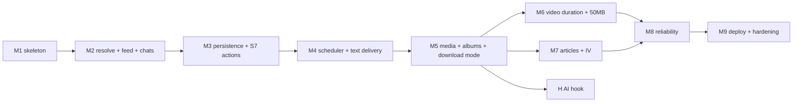

# FeedBerry Bot — Implementation Plan

**Status:** planning complete; implementation not started
**Date:** 2026-10-31
**Source of truth:** [ARCHITECTURE.md](ARCHITECTURE.md) §0–§17 and ADR-001…016
**Scope:** design and planning only. No application code, no dependencies, no scaffolding.

---

## 1. Purpose and source of truth

This file turns the architecture into an ordered, testable sequence. It does not restate the architecture;
it assigns every part of it to a milestone and says how that milestone is proven.

Conflict rule, in order: **ADR > ARCHITECTURE §14 (roadmap table) > this plan's prose**. Three ADRs exist
because §14 contradicts itself; they are listed in §10 of this file.

Reference keys such as `[TG-FAQ]` are defined in ARCHITECTURE §16. Anything unverified is tagged
`[assumption]`. No new external URLs are introduced here.

### 1.1 What every milestone must contain

| Field | Rule |
|---|---|
| Goal | One sentence: what a user or the operator can observe that they could not before |
| Tasks | Each task tagged with its anchor: stage `S1–S9` (§5.1), FSM state (§7.1), table (§6), render row `R1–R14` (§8.1), delivery rule (§9), platform row (§10), or section (§11/§12/§13) |
| Dependencies | Earlier milestones that must be complete |
| Verification | Exactly one primary check: an automated test with a named fixture, or one operator manual check |
| OQs resolved | OQ entries from ARCHITECTURE §15 that this milestone settles |

### 1.2 Non-negotiables carried through every milestone

- One process, one SQLite file, long polling (ADR-002, ADR-003, ADR-009).
- Heavy work only from a due source, a user tap, or a retry (constraint C2).
- Every failure renders `[🔁 Retry] [← Back]` (§11).
- Every callback is answered with `answerCallbackQuery` before any network work (§7.2).
- No live social-media scraping by the implementing agent (§7.2 of this file).
- No new dependency without an ADR. No code outside the module map in §2.
- No user credentials are stored; login-only sources are refused (ADR-017).

---

## 2. Target file layout

Proposed once, so milestones can name destinations. It mirrors pipeline stages 1–9, not layers.

```
src/
  main.ts                 boot order: config -> db -> bot -> worker -> tick
  config.ts               env + limits (MAX_SOURCES_PER_USER=250, MAX_CHATS_PER_USER=20,
                          MAX_DOWNLOAD_MB=100, BACKFILL_COUNT=5, MAX_SOURCE_AGE_DAYS=30,
                          WORKER_CONCURRENCY=2, MAX_DOWNLOADS_PER_DAY=30, TRIAL_ENABLED=false)
  db/
    schema.sql            the eight tables of §6 + jobs_one_active index (no credential table, ADR-017)
    index.ts              open/migrate/schema_version
    repos/{users,chats,sources,subscriptions,posts,deliveries,jobs,events}.ts
  bot/
    index.ts              polling adapter, allowed_updates (ADR-003)
    fsm.ts                states and transitions (§7.1)
    callbacks.ts          callback_data -> handler table (§7.2)
    screens/s1..s11.ts    one renderer per screen (§7.3)
    keyboards.ts          screen keyboards + [Retry] [Back]
    texts.ts              derived toast/caption strings, one place
  scheduler/{tick.ts,slots.ts}         §4.1-4.3
  jobs/{queue.ts,worker.ts}            claim, locked_at recovery, priorities (§4.4)
  pipeline/
    run.ts                stage orchestration + hooks (§5.7)
    s1-resolve.ts  s2-feed.ts  s3-classify.ts  s4-dedupe.ts
    s5-media.ts    s6-render.ts s7-deliver.ts s8-record.ts s9-cleanup.ts
  platform/{registry.ts,allowlist.ts,ssrf.ts}
  platform/feed/{native.ts,rsshub.ts,bluesky.ts}
  render/{plan.ts,caption.ts,albums.ts,video.ts,article.ts}
  telegram/{api.ts,ratelimit.ts,target.ts}   buckets, 429, chat_id+thread_id (§9)
  media/{cobalt.ts,probe.ts,thumb.ts}
  article/{readability.ts,telegraph.ts}
  obs/{log.ts,alerts.ts,status.ts}
test/
  fixtures/               hand-authored or operator-recorded, never live-fetched
  unit/  integration/
```

Rule: a stage file may call only `platform/`, `media/`, `article/`, `render/`, `telegram/`, `db/repos`.
`bot/` never imports `media/` or `article/` directly — it goes through `pipeline/run.ts`.
This is what keeps the Download mode (ADR-013) a wrapper and not a fork.

---

## 3. Milestone dependency graph



`M7` also depends on `M4` only; it is placed after `M5` to keep §14's numbering intact (§14 allows reordering
M4–M7). `M8` is drawn after both media and articles because its verification kills RSSHub during a fetch,
which needs a real deliverable to observe.

---

## 4. Milestones

### M1 — Skeleton, schema, S1/S2, callback router

**Goal.** The operator can start the bot on an empty database; a user gets S1, opens `Add source` (S2), and
returns with `Back`. Nothing else works, and nothing pretends to.

**Tasks.**

1. `config.ts`: load and validate `BOT_TOKEN`, `ADMIN_CHAT_ID`, `RSSHUB_BASE`; expose the §6
   limit table as config with the documented defaults; `TRIAL_ENABLED=false` (OQ-7). Fail fast with a readable
   error when the token is missing.
2. `db/schema.sql`: the eight tables from §6 exactly as written; include `UNIQUE(tg_chat_id, message_thread_id)`
   and the partial index `jobs_one_active`; `schema_version` row. No credential table or column (ADR-017).
   WAL + `busy_timeout` at open (§6, ADR-009).
3. `bot/index.ts`: long polling with `allowed_updates = [message, callback_query, my_chat_member]` (ADR-003).
   No webhook code.
4. `bot/fsm.ts`: `idle`, `awaiting_source_link`, `error`, `confirming_delete` with in-memory session keyed by
   user; persist the `users` row on first contact (OQ-15).
5. `bot/screens/s1.ts`: the S1 text and three buttons; `Sources: N / LIMIT` computed from
   `count(subscriptions)` and config; trial line hidden when `TRIAL_ENABLED=false` (OQ-7).
6. `bot/screens/s2.ts`: platform list matching the screenshot; Reddit absent, Snapchat labelled
   "single links only", Telegram behind `TELEGRAM_BETA=false` (OQ-1, OQ-2, OQ-3 are *decided* here, enforced
   in M2).
7. `bot/callbacks.ts`: `menu:add`, `nav:back`, `nav:home`, `err:retry` wired; `answerCallbackQuery` always
   called first (§7.2).
8. `obs/log.ts`: JSON lines to stdout with token/`Cookie` redaction (§12.1). No alerts yet.
9. Interim stubs, registered in Appendix A and removed by their milestone: `menu:sources` →
   "arrives in M3" toast, `menu:download` → "arrives in M5" toast.

**Dependencies.** None.

**Verification.** Automated, fake Bot API + temp DB: send `/start`, assert S1 contains `Sources: 0 / 250` and
exactly three buttons; tap `menu:add`, assert S2; tap `nav:back`, assert S1; restart the process, assert the
`users` row survived and S1 still renders.

**OQs resolved.** OQ-7 (plan/trial line), OQ-15 (two extra FSM states).

**Exit artifact.** S1 and S2 rendered from a real database; `schema_version = 1`.

---

### M2 — Resolve, feed adapter, chat registration, S3/S4

**Goal.** Send a profile link and see S3, then S4 with the five latest post titles and every chat the bot may
post to — with a channel where it is not admin refused, not listed.

**Tasks.**

1. `platform/registry.ts`: platform detection for the §10 matrix; accept `threads.com` **and** `threads.net`,
   normalize to `threads.com`, pass the bare username to RSSHub (OQ-4, corrected text in §10 of this file);
   treat Pinterest `/ideas/…` and `/search/…` as `E_PROFILE_ONLY`; treat Snapchat profile links as
   `E_NO_FEED` with the "single links only" explanation (OQ-1).
2. `platform/allowlist.ts` + `platform/ssrf.ts`: the five rules of §12.2 — scheme/port/length, per-platform
   host allowlist, single DNS resolve with private-range rejection and connect-by-IP, max 2 re-validated
   redirects, 10 s connect / 20 s total / 20 MB HTML cap.
3. `pipeline/s1-resolve.ts`: link → `SourceRef{platform, canonical_url, external_id, feed_url, strategy}`
   (stage 1), with `single_post` for Download mode future use.
4. `platform/feed/*`: stage 2 per §5.3 — `native_rss` (+ `<link rel="alternate">` discovery), `rsshub`
   (ADR-006, ADR-015), `bluesky_api` `[BSKY-API]`; parse RSS/Atom into
   `FeedItem{guid, link, title, published_at, summary, media[]}`.
5. `bot/screens/s3.ts` + `s4.ts`: S3 "Checking source:" then S4 with author, avatar, the last 5 items as
   `• [MM/DD HH:MM] — title` (ascending, per the S4 screenshot), and the destination list. Read-only: no
   `posts`/`sources` writes (ADR-015). 60 s in-memory preview cache.
6. Chat registration (ADR-014): `my_chat_member` handler → `getChat` → `getChatMember(bot)` →
   channel requires `administrator` **and** `can_post_messages` `[TG-ADMIN]` → upsert `chats`
   (`tg_chat_id`, `message_thread_id`, `can_post`, `verified_at`, `rights_json`); `message_thread_id`
   captured for forum topics (OQ-9). "Personal account" row always offered.
7. `E_LINK_INVALID`, `E_NO_FEED`, `E_PROFILE_ONLY`, `E_BOT_NOT_ADMIN` and `E_COOKIE_REQUIRED` wired into
   the `error` state with `[🔁 Retry] [← Back]` (§11). A feed that needs a login is **refused at add** and
   offered Download Mode instead; no credential is ever requested or stored (ADR-017).
8. Extend `bot/texts.ts` with the S3/S4 copy and every `E_*` string from §11, so error wording has one
   source of truth. Leave the Appendix A stubs untouched — M3 and M5 remove them.

**Dependencies.** M1.

**Verification.** Automated: fixture `ig-profile.rss` + `chats.json` (one admin channel, one plain member
channel) → assert S3 then S4 shows exactly 5 titles in ascending `published_at`; destination list contains
the admin channel and the personal row, and **not** the member channel; a second fixture with
`can_post_messages=false` → `E_BOT_NOT_ADMIN` and no row written.

**OQs resolved.** OQ-1, OQ-2, OQ-3, OQ-4, OQ-9.

**Exit artifact.** S4 matching the screenshot, populated from a fixture feed, with a verified destination list.

---

### M3 — Persistence, S5/S6, limits, S7 with live actions

**Goal.** Add a source for real: S5 "how do we add", S6 confirmation, then S7 lists it with health, and
disable/delete work.

**Tasks.**

1. `pipeline/s4-dedupe.ts` (write half): persist `sources` + `subscriptions`; `posts` rows for backfill
   candidates. `Add and send latest posts` marks the 5 newest as pending (oldest → newest) and the rest as
   seen; `Add without sending` marks all as seen (§5.4).
2. `bot/screens/s5.ts` + `s6.ts`: the two S5 buttons (`add:save`, `add:save_silent`), S6 "Data source «X» is
   added…" text.
3. Limits: `MAX_SOURCES_PER_USER` enforced per user (OQ-11); `E_SOURCE_LIMIT`, `E_DUPLICATE` on
   `UNIQUE(source_id, chat_id)` (OQ-10).
4. `bot/screens/s7.ts`: source cards with `id: #<id>`, `source checked: <age>`, health fields from §6,
   filter chips and pagination (`src:page`, `src:filter`), Back (S7 shows `Showing a–b of n`).
5. S8 toggle: `src:on`/`src:off` → `sources.enabled` + toast verbatim from the screenshot.
6. S10/S11 delete: `src:del` → confirm screen → `src:delok` cascades `subscriptions`, orphan `sources`,
   `posts`, and the secret (OQ-17 mechanics); `src:delno` re-renders S7 (ADR-016).
7. Remove the `menu:sources` stub.

**Dependencies.** M2.

**Verification.** Automated: set `MAX_SOURCES_PER_USER=2`, add a third source → `E_SOURCE_LIMIT`; add the same
source twice to one chat → `E_DUPLICATE`; toggle → `sources.enabled=0` and the S8 toast; delete → no
`subscriptions`, orphan `sources` or `posts` rows remain.

**OQs resolved.** OQ-10, OQ-11 (the no-credential policy is ADR-017).

**Exit artifact.** S7 rendering real rows, with all three card actions working.

---

### M4 — Scheduler, jobs, text delivery, manual check

**Goal.** Leave the bot alone with a 1-minute source and receive its new text posts once, in order, with no
duplicates after a restart.

**Tasks.**

1. `scheduler/tick.ts`: the two queries of §4.2 every 30 s; insert one `fetch_source` per due source; advance
   every due `next_slot_at` **before** enqueueing (§4.3); skip a slot more than 12 h late (ADR-010).
2. `scheduler/slots.ts`: `slot_after(now, tz, interval)` — 08:00/20:00 in the user's tz, or `now + interval`;
   DST by wall-clock recomputation, never by adding 12 h.
3. `jobs/queue.ts`: claim with the single `UPDATE … RETURNING` of §4.4; `locked_at` recovery at 10 min;
   priorities manual 100 / scheduled 50 / backfill 40 / retry 10; `jobs_one_active` prevents duplicates.
4. Pipeline stages 2 → 3 → 4 → 6 → 7 → 8 for text: `s3-classify` returns `text`, `s4-dedupe` reads `posts`,
   `s6-render` emits R1, `s7-deliver` sends, `s8-record` writes `deliveries`, `posts`, and
   `last_check_at`/`last_ok_at`.
5. `telegram/ratelimit.ts`: per-chat 1 msg/s and global 30 msg/s buckets; group window 20/min `[TG-FAQ]`;
   per-chat serializer so two subscriptions cannot interleave.
6. Minimal 429: read `parameters.retry_after` `[TG-429]`, sleep `retry_after + 1 s`, retry once. Full policy
   is M8.
7. S9 manual check: `src:check` → `answerCallbackQuery` with the screenshot text → priority-100
   `manual_check` job that never moves `next_slot_at` (§4.6, ADR-016).
8. Ordering: oldest → newest, unseen only (§9.3). Remove the `menu:download` stub only in M5.

**Dependencies.** M3.

**Verification.** Automated, fixture `text-source.rss` with `interval_minutes=1`: run one tick → exactly one
R1 message delivered and `next_slot_at` advanced; run a second tick immediately → zero messages; send
`src:check` → job inserted, toast answered, `next_slot_at` unchanged.

**OQs resolved.** None — scheduling is fully specified in §4.

**Exit artifact.** A delivered text post and a `source checked: <1m` field that keeps changing.

---

### M5 — Media, albums, caption splitting, Download mode

**Goal.** Photo and album posts arrive as native media with the right caption; a 1000-character caption does
not get truncated; the S1 "Download Mode" button downloads a single post without subscribing.

**Tasks.**

1. `pipeline/s5-media.ts`: `cobalt.resolve()` (metadata only) → `cobalt.download()` into
   `/tmp/media/<job>`, `AbortSignal` on job timeout, `MAX_DOWNLOAD_MB` pre-check, picker index selection
   `[COBALT-README]`.
2. R2 (single photo), R3 (album), R5 (mixed → sequential), R10 (animation), R11 (audio), and **R9** for every
   video this milestone (duration unknown until M6).
3. `render/caption.ts`: the five rules of §8.2 — 1024/4096 limits, word-boundary split, ` (i/n)` suffix only
   when `n > 1`, continuation as a reply chain, plain-text resend on `E_TG_PARSE`.
4. `render/albums.ts`: 2–10 per `sendMediaGroup` `[TG-MG]`, chunking beyond 10 (R4), caption on the first item
   only.
5. Token accounting: an album reserves one token per item against the group/global buckets (OQ-12).
6. Download mode (ADR-013, OQ-8): `menu:download` live; stages 1, 3–7; `deliveries.post_id = NULL`;
   `MAX_DOWNLOADS_PER_DAY`; profile links rejected with "Send a post link, not a profile."
7. Consume the M3 backfill marker: send pending items oldest → newest at 1 msg/s (§9.3).
8. `s9-cleanup.ts`: delete the job's temp directory on success and on every error path.

**Dependencies.** M4.

**Verification.** Automated with fixtures (`photo.jpg`, `album-3/`, `album-11/`, `video-9mb.mp4`,
`caption-1025.txt`): assert `sendPhoto` ×1; `sendMediaGroup` ×1 with 3 items; 11 items → 10 + 1; the 1025-char
caption → two messages whose text ends `(1/2)` and `(2/2)`; the 9 MB video → `sendVideo`.

**OQs resolved.** OQ-8, OQ-12.

**Exit artifact.** An album post delivered with one caption, and a working Download Mode reply.

---

### M6 — Video duration rule and the 50 MB wall

**Goal.** A 2-minute clip plays inline; a 4-minute clip arrives as a thumbnail with a link; a 61 MB file never
half-uploads.

**Tasks.**

1. `media/probe.ts`: duration in the §8.6 order — `ffprobe format=duration` when `hasFFmpeg()`
   `[COBALT-README]`, else `itunes:duration`/`media:content`, else unknown; the engine exposes no duration
   today `[COBALT-ENGINE]` (OQ-18).
2. `render/video.ts`: R6 (< 3 min, ≤ 50 MB → `sendVideo`, `supports_streaming`), R7 (< 3 min, > 50 MB →
   thumbnail + caption + link), R8 (≥ 3 min → thumbnail + link), R9 refinement for unknown duration.
3. `media/thumb.ts`: platform poster first, else ffmpeg frame at 1 s; if neither, R14 text + link.
4. Pre-upload size decision from the downloaded file, never from a partial send (§8.4, ADR-012).
5. `E_TOO_LARGE` recorded as a silent success path, not a failure (§11).
6. Record the engine follow-up "expose `duration` in `resolve()`" as a future item — no engine change here.

**Dependencies.** M5.

**Verification.** Automated with three fixtures: `video-2m.mp4` → `sendVideo`; `video-4m10.mp4` → one
`sendPhoto` (thumbnail) plus one `sendMessage` carrying the source link, and **no** `sendVideo`;
`video-61mb.mp4` → same as the 4-minute case, with zero upload attempts.

**OQs resolved.** OQ-5, OQ-18.

**Exit artifact.** The three video outcomes visible in one chat, in order.

---

### M7 — Articles and Instant View

**Goal.** A Wired or TechCrunch link arrives as a readable article that opens in Instant View, without ads,
and degrades to a link card when extraction fails.

**Tasks.**

1. `article/readability.ts`: fetch HTML through the §12.2 guard, run Readability, sanitize, apply the
   image-URL fixes (`formatbot1/src/api/utils/fixImages.js`, `is-image-url.js` rules) `[FB-README]`.
2. `article/telegraph.ts`: HTML → Telegraph nodes, `createPage` with `author_name` 0–128 and title ≤ 256
   `[TG-TELEGRAPH]`; pages over 64 KB chained with "Read Next page", ported from
   `formatbot1/src/api/utils/makeTelegraph.js` `[FB-TELEGRAPH]`.
3. R12: `sendMessage` with the `telegra.ph` URL and link preview enabled; R13 when readable text < 400 chars
   or `createPage` fails; R14 for everything else.
4. `s3-classify`: choose `article` when the feed item has no media and the target is HTML.
5. No headless browser (no `NO_PUPPET` equivalent toggle yet); record the Tier 3 flag as operator-only.
6. Wording and disclosure: keep "Instant View" in the UI text (OQ-14); add the one-line fidelity limit from
   OQ-6 to the README when it is written.
7. Record that `t.me/iv?url=…&rhash=…` is an operator-only escape hatch for owned domains (OQ-13).

**Dependencies.** M4 (delivery). Placed after M5 to keep §14 numbering.

**Verification.** Automated with fixtures `wired.html` (12 KB article) and `long-70kb.html`: the first yields
exactly one `createPage` call and a message containing a `telegra.ph` URL; the second yields two chained
pages; `thin.html` (200 readable chars) yields R13 with the original link and no `createPage` call.

**OQs resolved.** OQ-6, OQ-13, OQ-14.

**Exit artifact.** An article post delivered as an IV-opening link, and a thin page delivered as a link card.

---

### M8 — Reliability: retries, 429, health, alerts

**Goal.** Kill RSSHub mid-fetch and the user sees nothing broken, the source shows the real failure reason,
and the operator gets one alert — not a hundred.

**Tasks.**

1. Retry/backoff table §4.5 in `jobs/queue.ts` (network/5xx 1 m→6 h, max 5; rate limit 30 m→8 h, max 3;
   login wall: no retry, `needs_login`; media terminal).
2. Full 429 policy §9.2: `retry_after + 1 s`; if `retry_after > 300 s`, requeue with `run_after` and free the
   worker; 429 never consumes a job attempt.
3. Error mapping §11 end to end: `E_COOKIE_REQUIRED`, `E_RATE_LIMIT`, `E_FEED_DOWN`, `E_NO_MEDIA`,
   `E_MEDIA_GONE` (one fresh resolve), `E_TELEGRAPH`, `E_TG_PARSE`, `E_TG_FORBIDDEN` (demote `chats.can_post`),
   `E_TG_429`, `E_TG_UNKNOWN`.
4. Health: `last_error_code`, `last_error_at`, `consecutive_failures`, `events` rows; one owner notice per
   24 h after 3 consecutive failures (§4.5).
5. `obs/alerts.ts` §13.1: 3 consecutive failures, `jobs` queued > 100, no successful fetch in 26 h while
   sources exist — each a single DM to `ADMIN_CHAT_ID`.
6. `obs/status.ts`: `/status` for the admin only (queued jobs, failing sources, last 24 h counters).
7. Audit pass: every failure path in `bot/screens/*` ends with `[🔁 Retry] [← Back]`; no scheduled-path
   failure messages a user.
8. OQ-16 decision record after M7's fidelity check: `sendRichMessage` stays unused; write the revisit trigger
   (client coverage confirmed across Telegram Desktop, Android, iOS, Web) `[TG-SENDRICH]`.

**Dependencies.** M6, M7.

**Verification.** Automated, fixture `rsshub-502.json`: three ticks → `consecutive_failures = 3`, exactly one
`events` row per tick, exactly one admin DM total; then fixture `tg-429-retry7.json` → the sender waits 8 s and
succeeds on the second attempt without incrementing `attempts`.

**OQs resolved.** OQ-16.

**Exit artifact.** S7 showing `source checked: <age>` plus a real error reason, and one admin alert.

---

### M9 — Deploy, backup/restore, hardening

**Goal.** A clean host reaches a delivered post from a compose file and a runbook, and a restore from backup
brings the same state back.

**Tasks.**

1. `docker-compose.yml` per ADR-017 (Oracle primary, Pi fallback; ADR-010 superseded): `bot` (node:22-alpine + ffmpeg) and `rsshub`
   (`diygod/rsshub:latest`, no Chromium) `[RH-DEPLOY]`; volumes for `/data`; tmpfs for media;
   `restart: unless-stopped`; healthchecks.
2. `.env.example` and the runbook of §13.3, including the Oracle caveats (capacity errors, idle reclamation)
   `[ORACLE]`.
3. Backup: nightly `sqlite3 .backup` + off-box copy; restore drill documented and executed once.
4. Security audit: confirm no credentials are stored anywhere (ADR-017), redaction test (no bot token,
   cookie header or RSSHub key in logs), §12.4 quota enforcement, `chats` re-verification on `403`,
   `MAX_SOURCE_AGE_DAYS` retention job (§13.1).
5. Load smoke: 20 sources × 2 chats with fixture feeds; assert queues drain and 1 msg/s is respected.
6. Platform smoke per the §10 matrix, run by the operator with the brief's links (Snapchat single link,
   Pinterest `/ideas/` rejection, Instagram login-wall refusal) — not by the agent.
7. Remove every remaining stub (Appendix A).

**Dependencies.** M8.

**Verification.** Operator manual: on a fresh host, `docker compose up -d`, `/status` answers, add one source,
receive one post; then stop the bot, restore the nightly backup, start, and `/status` reports the same source
and chat counts.

**OQs resolved.** OQ-17.

**Exit artifact.** A reproducible deployment and a proven restore.

---

### Milestone H — AI hook (extension point only)

**Goal.** Prove the pipeline can be extended after `render` without touching code, and prove nothing changes
when no hook is registered.

**Tasks.**

1. `pipeline/run.ts`: `hooks: Array<{id, after, run(ctx)}>`, registered at boot, empty by default (§5.7).
2. `ItemContext` immutable; a hook may replace the `MessagePlan` only; no hook receives a Telegram client.
3. Document in the code comment why delivery stays in stage 7 (rate limiting cannot be bypassed).
4. One test registers a no-op hook.

**Dependencies.** M5.

**Verification.** Automated: register a no-op hook that records its invocation; assert it is called exactly
once after `render`, and the delivered message is byte-identical to the baseline run.

**OQs resolved.** None (the AI features remain future work).

**Exit artifact.** A delivered post byte-identical to the baseline run, plus a `hook noop after=render` log line.

---

## 5. Milestone summary

| M | Scope | Depends | Verification | OQs |
|---|---|---|---|---|
| M1 | Config, schema, FSM, S1/S2, router | — | `/start` → S1 (`0 / 250`), S1→S2→Back, survives restart | 7, 15 |
| M2 | Stage 1–2, S3/S4, chat verification | M1 | Fixture feed → 5 titles; non-admin channel refused | 1, 2, 3, 4, 9 |
| M3 | Persist, S5/S6/S7, S8, S10/S11 | M2 | Limit 2 → 3rd add fails; delete leaves no rows | 10, 11 |
| M4 | Tick, jobs, slots, R1, S9 | M3 | interval=1 min → one message, slot advanced, no duplicate | — |
| M5 | Media, R2–R5/R9/R10/R11, split, Download mode | M4 | Album 3 → one group; 1025-char caption → `(1/2)`,`(2/2)` | 8, 12 |
| M6 | Duration, R6/R7/R8, 50 MB | M5 | 4:10 video → thumbnail + link, no upload | 5, 18 |
| M7 | Articles, R12/R13, Telegraph | M4 (after M5) | Wired fixture → one `createPage`, `telegra.ph` URL | 6, 13, 14 |
| M8 | Retries, 429, health, alerts | M6, M7 | RSSHub 502 ×3 → 3 failures, 1 alert; 429 waits 8 s | 16 |
| M9 | Compose, runbook, backup, hardening | M8 | Fresh host → post delivered; restore → same counts | 17 |
| H | `pipeline.hooks`, no-op test | M5 | Hook called once, message unchanged | — |

---

## 6. Traceability

### 6.1 Architecture section → milestone

| § | Covered by | Note |
|---|---|---|
| §0 reading guide | this file §1 | conflict rule states ADR > §14 |
| §1 goals/non-goals/constraints/assumptions | M1 (constraints as config), M9 (C1/C2 proof) | non-goals are enforced by omission |
| §2 context/components | M1 (process, DB), M4 (RSSHub call), M5 (cobalt call) | no component added later |
| §3 runtime/language | M1 | Node 22 + TS + grammY |
| §4 scheduler/queue | M4 | tick, slots, claim, backoff (M8) |
| §5 pipeline | M2 (1–2), M4 (3–4, 6–7 text), M5 (5), M7 (article), M9 (9 audit) | stage 8 in M4/M8 |
| §6 data model | M1 (schema, no credential table), M3 (sources/subscriptions/posts), M4 (jobs/deliveries), M8 (health/events) | schema is complete in M1 |
| §7 bot layer | M1 (FSM, S1/S2), M2 (S3/S4), M3 (S5/S6/S7/S8/S10/S11), M4 (S9) | ADR-014/016 |
| §8 rendering | M4 (R1, R14), M5 (R2–R5, R9–R11), M6 (R6–R8), M7 (R12/R13) | R9 refined in M6 |
| §9 delivery | M4 (buckets, floor 429), M5 (albums, backfill), M8 (full 429) | 429 floor in M4, full policy in M8 |
| §10 platform matrix | M2 (gating/allowlist), M6 (YouTube duration), M7 (articles), M9 (per-platform smoke) | Snapchat single-link, Reddit excluded, Pinterest users only |
| §11 failure mapping | M2, M3, M6, M8 (full audit) | each code lands with its cause |
| §12 security | M2 (SSRF, admin), M3 (cascade delete), M9 (no credentials, quotas) | SSRF guard precedes every fetch; nothing secret is stored |
| §13 observability/deploy | M8 (alerts, `/status`), M9 (compose, runbook, backup) | alerts M8; compose and runbook M9 |
| §14 roadmap | this file §4–§5 | superseded where ADR-014/015/016 apply |
| §15 open questions | this file §4 (per milestone) + §10 | all 18 assigned |
| §16 sources | every claim above | no new URLs |
| §17 ADR index | M1 references ADR-001…003, etc. | append 014–016 |

### 6.2 Pipeline stage → milestone

| Stage | 1 resolve | 2 fetch_feed | 3 classify | 4 dedupe | 5 prepare_media | 6 render | 7 deliver | 8 record | 9 cleanup |
|---|---|---|---|---|---|---|---|---|---|
| Milestone | M2 | M2 | M4 (text), M5 (media), M7 (article) | M4 | M5 | M4–M7 | M4 | M4, M8 | M5 |

### 6.3 FSM state → milestone

| State | idle | awaiting_source_link | checking | preview | add_mode | done | error | confirming_delete |
|---|---|---|---|---|---|---|---|---|
| Milestone | M1 | M1 | M2 | M2 | M3 | M3 | M1 (component), M2 (real errors) | M3 |

### 6.4 Render row → milestone

| Row | R1 | R2 | R3 | R4 | R5 | R6 | R7 | R8 | R9 | R10 | R11 | R12 | R13 | R14 |
|---|---|---|---|---|---|---|---|---|---|---|---|---|---|---|
| Milestone | M4 | M5 | M5 | M5 | M5 | M6 | M6 | M6 | M5 (intro), M6 (refine) | M5 | M5 | M7 | M7 | M4 |

### 6.5 Open question → milestone

| OQ | 1 | 2 | 3 | 4 | 5 | 6 | 7 | 8 | 9 | 10 | 11 | 12 | 13 | 14 | 15 | 16 | 17 | 18 |
|---|---|---|---|---|---|---|---|---|---|---|---|---|---|---|---|---|---|---|
| M | 2 | 2 | 2 | 2 | 6 | 7 | 1 | 5 | 2 | 3 | 3 | 5 | 7 | 7 | 1 | 8 | 9 (+3) | 6 |

---

## 7. Fixtures and test policy

### 7.1 Fixtures

- Stored under `test/fixtures`, one directory per case, named in the milestone's verification line.
- **Hand-authored or operator-recorded.** The implementing agent must not fetch live social-media URLs to
  create a fixture — that is outside the action boundary. Where a real payload shape is needed, the operator
  records it once and commits it.
- Media fixtures are tiny synthetic files (`photo.jpg` a few KB, `video-2m.mp4` under 1 MB) plus two
  size-patched copies for the 50 MB branch: patch the container header rather than shipping 61 MB.

### 7.2 Manual acceptance by the operator

The brief's 24 links are grouped by milestone and never run by the agent:

| Milestone | Links | What it proves |
|---|---|---|
| M2 | 4, 5, 12, 13, 14, 15, 16, 17, 22, 23 | profile resolve, Threads both hosts, Tumblr/Bluesky routes |
| M5 | 1, 2, 3, 4, 5, 8, 10 | media download and album rendering |
| M6 | 8 (YouTube) | duration + thumbnail path |
| M7 | 24, 25 | article extraction and IV |
| M9 | 6, 7 (Pinterest `/ideas/`), 10 (Snapchat) | rejection and single-link paths |

### 7.3 Test pyramid (deliberately small)

- Unit: renderer (`plan`, `caption`, `albums`, `video`), slots math, SSRF guard, error mapping. Pure functions,
  no network.
- Integration: pipeline against fixtures with a fake Telegram API that records calls and can be told to return
  429/403/`can't parse entities`.
- One end-to-end per milestone in §4. No browser tests, no load test beyond the M9 smoke.

---

## 8. Definition of done (every milestone)

A milestone is done when all five hold:

1. The verification line passes from a clean database.
2. The exit artifact is observable by a user or the operator, not only in logs.
3. No stub introduced by an earlier milestone is still reachable (Appendix A).
4. No dependency added; no file created outside the §2 map; one fixture per new branch.
5. The next milestone's dependencies are unblocked — checked by reading its "Dependencies" line.

---

## 9. Carry-forward risks

| # | Risk | Monitor | Trigger to act |
|---|---|---|---|
| 1 | Instagram/X/Facebook refuse login-only feeds; a datacenter IP makes blocking likelier `[RH-CONFIG][RH-IGISSUE][X-TOS][ORACLE]` | `E_COOKIE_REQUIRED` / `E_RATE_LIMIT` counts in `events` | > 30 % of a platform's checks failing over 24 h → demote its `Rel.` grade in §10 |
| 2 | 3-minute rule unverifiable without ffprobe (`[COBALT-ENGINE]`, OQ-18) | share of items falling to R9 | > 20 % → prioritise engine `duration` exposure (M6 follow-up) |
| 3 | RSSHub is a single point of failure `[RH-DEPLOY]` | `E_FEED_DOWN` rate, `/status` | 3 consecutive failures → M8 alert already fires; add a second instance only with an ADR |
| 4 | Host loss (Oracle idle reclamation is now the primary path `[ORACLE]`; a home power cut applies to the fallback) | nightly backup freshness | backup older than 48 h → alert |
| 5 | Derived UI contract drifts (`docs/UI_SPEC.md` absent) | screenshot-vs-render diff in M1/M2 review | any mismatch → fix the screen, not the spec |
| 6 | Resequencing invalidates §14 for later readers | this file §10 + ADR-014/015/016 | if another dependency inversion appears → new ADR before moving work |

---

## 10. Corrections log

Applied while writing this plan:

1. **OQ-4 repaired.** The architecture file's OQ-4 had been reduced to "`threads.com` vs `threads.com`" — a
   self-referential conflict. Restored to "`threads.com` vs `threads.net`", and the default now reads: accept
   both input hosts, normalize to `threads.com` for the canonical URL, pass the bare username to RSSHub
   `[RH-THREADS]`. No design change.
2. **Milestone resequencing**, recorded in three ADRs because §14's own dependencies force it:
   - [ADR-014](adr/014-chat-registration-in-m2.md) — chat registration and admin verification move M9 → M2.
   - [ADR-015](adr/015-feed-adapter-in-m2.md) — pipeline stage 2 moves M4 → M2; scheduling stays in M4.
   - [ADR-016](adr/016-source-list-actions-in-m3.md) — S8/S10/S11 move M8 → M3; S9 stays in M4.
3. **Clarifications, not deviations:**
   - M5 proves the video path through R9 (unknown duration); M6 upgrades it to R6/R7/R8.
   - M4 ships the minimal 429 handler; M8 owns the full policy.
   - M7 is ordered after M5 although it only needs M4, to keep §14's numbering stable.
4. **Owner decisions (2026-10-31, ADR-017).** All 18 OQs decided: Reddit removed, no credentials stored
   (the `secrets` table and `auth_ref` are dropped), Oracle Cloud is primary. M1–M3, M8, M9, §2, §6.1 and the
   risk table were updated; §17 now indexes 014–017.

Superseded text: the M2, M5 and M9 rows of ARCHITECTURE §14 remain as written and are overridden by
ADR-014/015/016; ADR-017 records the owner decisions. The ADR index in §17 is extended with 014–017.

---

## Appendix A — Stub register

| Stub | Introduced | Removed | Visible as |
|---|---|---|---|
| `menu:sources` toast "arrives in M3" | M1 | M3 | toast only |
| `menu:download` toast "arrives in M5" | M1 | M5 | toast only |
| backfill pending until a renderer exists | M3 | M5 | text items from M4, media from M5 |

Rule: a stub may not outlive its removal milestone; §8 item 3 checks this.
